<div align="center">
  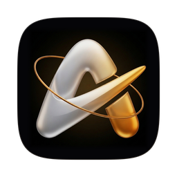

  <h1>Antigravity Manager</h1>

  <p>
    <strong>Zero-Proxy Multi-Host Account Orchestrator, Dual-Pool Quota Monitor &amp; Local Telemetry Studio</strong><br />
    <sub>Switch Google AI accounts seamlessly across Antigravity App, IDE, ACP Plugin &amp; CLI — with isolated hardware fingerprints, menu bar quick-switch, and zero-MITM local SQLite analytics.</sub>
  </p>

  <p>
    <a href="https://raw.githack.com/lbjlaq/Antigravity-Manager/antigravity-manager/docs/index.html"></a>
    <a href="https://github.com/lbjlaq/Antigravity-Manager/releases/tag/antigravity-manager"></a>
    <a href="https://github.com/lbjlaq/Antigravity-Manager/tree/antigravity-manager"></a>
    
    
    
    <a href="https://t.me/AntigravityManager"></a>
    <a href="https://github.com/sponsors/lbjlaq"></a>
    <a href="LICENSE"></a>
  </p>

  <p>
    <a href="https://trendshift.io/repositories/18224?utm_source=repository-badge&utm_medium=badge&utm_campaign=badge-repository-18224" target="_blank" rel="noopener noreferrer">
      
    </a>
  </p>

  <p>
    <strong>English</strong> · <a href="./README_ZH.md">简体中文</a>
    &nbsp;&nbsp;|&nbsp;&nbsp;
    <a href="#-sponsors">Sponsors</a> ·
    <a href="#-highlights">Highlights</a> ·
    <a href="#-visual-tour">Visual Tour</a> ·
    <a href="#-installation--macos-gatekeeper-fix">Install</a> ·
    <a href="#-cli-tooling-am">CLI (<code>am</code>)</a> ·
    <a href="#-architecture">Architecture</a>
  </p>

  <br />

  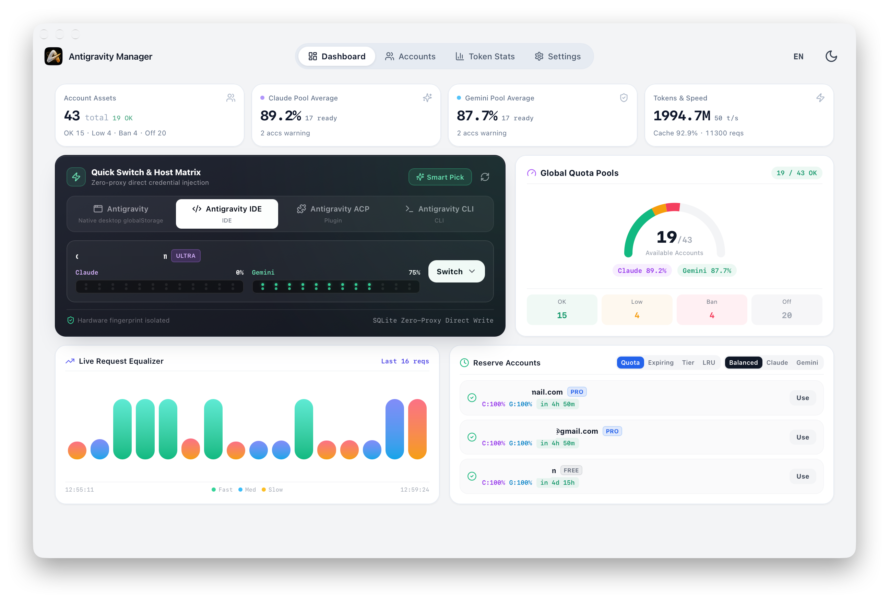
</div>

## 📦 Editions &amp; Quick Download

Choose the channel that best fits your workflow (both editions share `~/.antigravity_tools/` seamlessly and can run side-by-side without conflict):

| Edition / Channel | Positioning | Best For | Direct Download / Homebrew |
| :--- | :--- | :--- | :--- |
| **⚡ Antigravity Manager (Current Branch)** | Lightweight **zero-proxy** 4-host switcher, dual-pool quota monitor, local SQLite telemetry &amp; `am` CLI ([`antigravity-manager`](https://github.com/lbjlaq/Antigravity-Manager/tree/antigravity-manager)) | Seamless account switching &amp; quota monitoring without running a local proxy | **[Download Manager](https://github.com/lbjlaq/Antigravity-Manager/releases/tag/antigravity-manager)** · `brew install --cask antigravity-manager` |
| **🚀 Antigravity Tools (Stable)** | Full AI protocol proxy &amp; relay gateway ([`main`](https://github.com/lbjlaq/Antigravity-Manager/tree/main)) | Local OpenAI / Anthropic Claude / Gemini API conversion, Docker &amp; headless deployment | **[Download Latest](https://github.com/lbjlaq/Antigravity-Manager/releases/latest)** · `brew install --cask antigravity-tools` |
| **🧪 Antigravity Tools (Beta Preview)** | Early-access preview builds ([`beta`](https://github.com/lbjlaq/Antigravity-Manager/tree/beta)) | Testing upcoming model routing &amp; protocol adaptations | **[Download Preview](https://github.com/lbjlaq/Antigravity-Manager/releases/tag/preview)** |

> First time using Homebrew? Run `brew tap lbjlaq/antigravity-manager https://github.com/lbjlaq/Antigravity-Manager` once, then install either cask above.

---

## 💖 Sponsors

| Sponsor | Description |
| :---: | :--- |
|  | Thanks to **PackyCode** for sponsoring this project! PackyCode is a reliable and efficient API relay service provider offering relays for Claude Code, Codex, Gemini, and more. Register using [this link](https://www.packyapi.com/register?aff=Ctrler) and enter the **"Ctrler"** coupon code when topping up to enjoy a **10% discount**. |
| 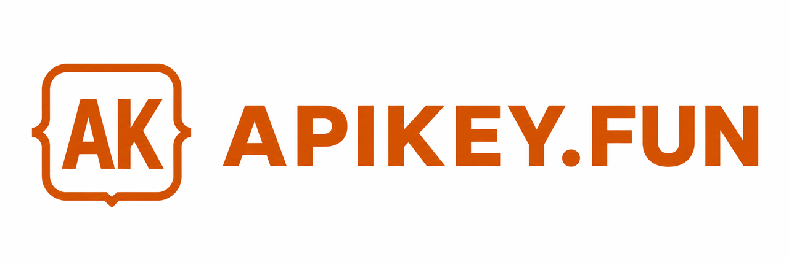 | Thanks to **APIKEY.FUN** for sponsoring this project! APIKEY.FUN is an enterprise-grade AI relay station providing stable, high-efficiency, and low-cost AI model API access for Claude, OpenAI, Gemini, and more (as low as 7% of official pricing). Register via [this exclusive link](https://apikey.fan/register?aff=AntManager) to enjoy up to **permanent 5% off on top-ups**. |
|  | Thanks to **Claude API** for supporting this project! claudeapi.com is a **Claude API** relay station built on **official and AWS channels**, delivering high stability and low latency with full Claude Code support. Register via [this exclusive link](https://console.claudeapi.com/register?source=antigravity) to get **free trial credits** and an extra **5% off** on top-ups (Contact Support). |
| 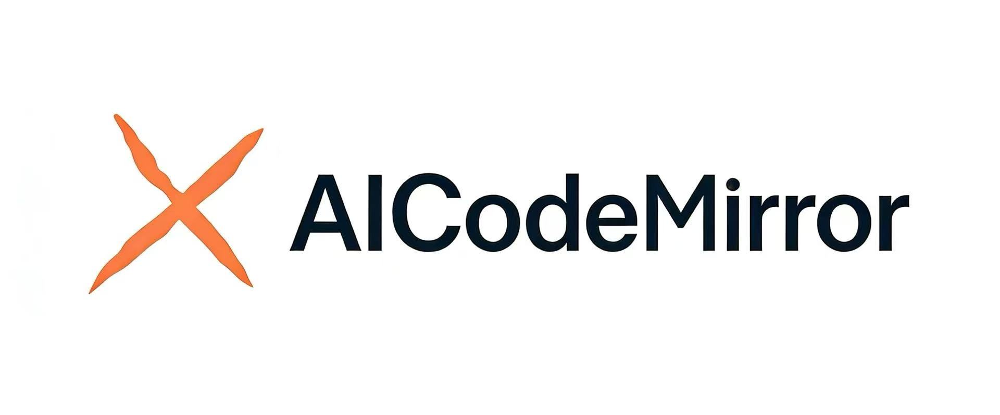 | Thanks to **AICodeMirror** for sponsoring this project! AICodeMirror provides official high-stability relay services for Claude Code / Codex / Gemini CLI with enterprise concurrency and 24/7 support. Register via [this link](https://aicodemirror.ai/register?invitecode=MV5XUM) for **20% off your first top-up** (up to 25% off for enterprise users). |

### ☕ Support the Author

If you find **Antigravity Manager** helpful, feel free to support ongoing development via [GitHub Sponsors](https://github.com/sponsors/lbjlaq) or Buy Me a Coffee. Want your GitHub avatar or logo featured in this README? Choose the **README Backer ($25/mo)** or **Silver Sponsor ($150/mo)** tier on GitHub Sponsors:

<p align="center">
  <a href="https://github.com/sponsors/lbjlaq" target="_blank" rel="noopener noreferrer">
    
  </a>
  &nbsp;&nbsp;
  <a href="https://www.buymeacoffee.com/Ctrler" target="_blank" rel="noopener noreferrer">
    
  </a>
</p>

<table>
  <tr>
    <td align="center" width="33.3%">
      <br />
      <sub><b>Alipay</b></sub>
    </td>
    <td align="center" width="33.3%">
      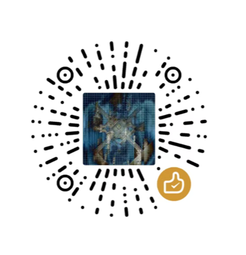<br />
      <sub><b>WeChat Pay</b></sub>
    </td>
    <td align="center" width="33.3%">
      <br />
      <sub><b>Buy Me a Coffee</b></sub>
    </td>
  </tr>
</table>

---

## ✨ Highlights

- ⚡ **Zero-Proxy Direct Credential Injection** — No local reverse proxy, no TLS/MITM interception, and no extra network hop. Writes OAuth state &amp; Protobuf sentinel keys directly into target host `globalStorage` (`state.vscdb`) and OS Keyring (`Keychain` / `Win32 Credential Manager` / `Secret Service`) with sub-second hot-switching.
- 🎯 **4-Host Unified Matrix (`App · IDE · ACP · CLI`)** — Manage and switch active accounts independently or simultaneously across **Antigravity Desktop App**, **Antigravity IDE**, **VS Code / Cursor ACP Plugin**, and **Antigravity CLI (`agy`)**.
- 🔋 **Dual-Window Quota Engine (`5h Stream` &amp; `7d Reservoir`)** — Real-time polling and dot-matrix visualization for both **Gemini** and **Claude** model pools, subscription tier detection (`ULTRA` / `PRO` / `FREE`), reset countdowns, and `Smart Pick` routing (`Max Quota`, `Expiring Soon`, `Tier First`, `Balanced LRU`).
- 🛡️ **Hardware Fingerprint Isolation** — Generates, binds, and persists an independent device fingerprint profile per account to prevent cross-account correlation during multi-account rotation.
- 📊 **Local SQLite Telemetry &amp; Shareable HD Posters** — Inspect total tokens, prompt cache hit rates, TTFT &amp; generation speed (`tok/s`), tool-call matrices, 6-axis workspace radars, and live request ledgers directly from local SQLite — plus 1-click `1280×720` HD share posters (`Polar`, `Radial`, `Hex Core`, `Matrix`).
- 🪟 **Menu Bar Mini Popover &amp; Lightweight Mode** — Always-ready system tray popover for instant host switching and live daily token rhythm. Optional **Lightweight Mode** releases the WebView renderer process when hidden to keep background memory footprint minimal.
- 💻 **First-Class Headless CLI (`am`)** — Complete 20+ subcommand parity between GUI and terminal (`am list`, `am switch`, `am login --manual`, `am stats`, `am watch`, `am context`, `am doctor`) powered by the shared `am-core` Rust crate.
- 🌍 **12 Languages &amp; 100% Local Privacy** — Built-in localization (`EN`, `ZH`, `ZH-TW`, `JA`, `KO`, `RU`, `ES`, `PT`, `TR`, `VI`, `AR`, `MY`). All tokens, fingerprints, and telemetry stay encrypted/stored locally on your machine with zero remote upload.

---

## 🪟 Menu Bar Mini Popover

Pin Antigravity Manager to your menu bar / system tray and toggle effortlessly between **4-Host Smart Switch** and **Today's Live Telemetry** without leaving your coding flow.

<table>
  <tr>
    <td width="50%" align="center">
      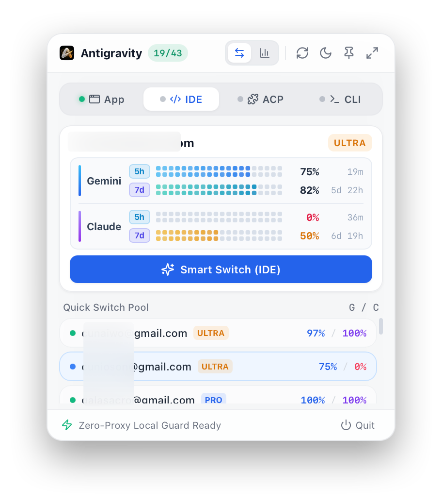<br />
      <sub><b>Quick Switch Mode</b> — Live 4-host status dots (<code>App · IDE · ACP · CLI</code>), active Claude/Gemini pool bars, 1-click <code>Smart Switch</code>, and reserve pool list.</sub>
    </td>
    <td width="50%" align="center">
      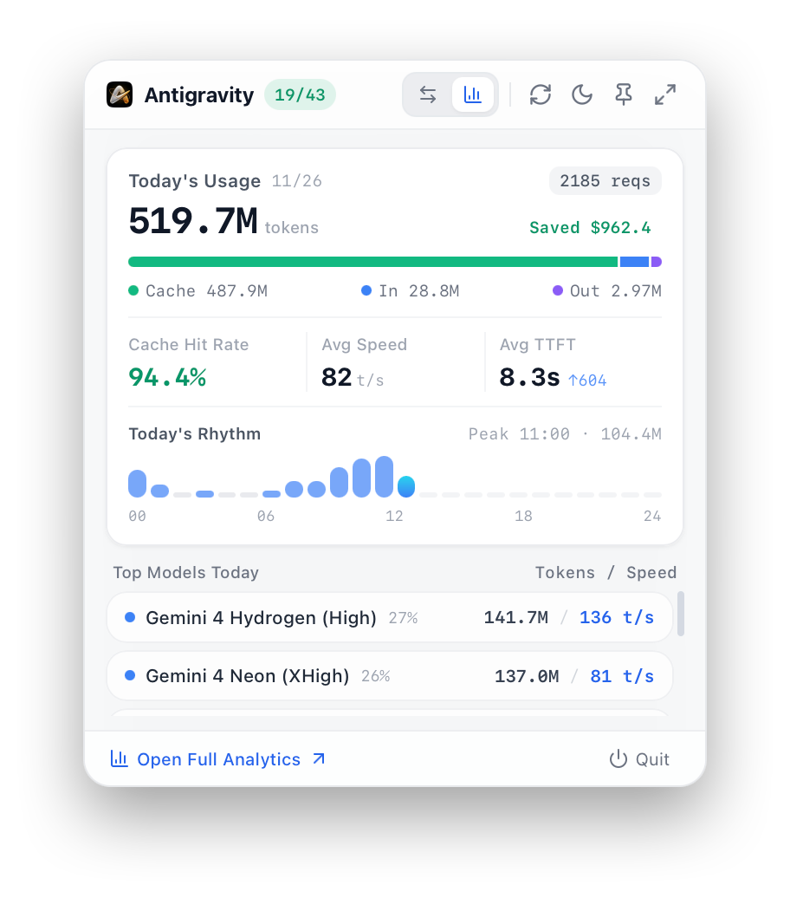<br />
      <sub><b>Live Telemetry Mode</b> — Today's token volume, estimated cache savings, cache hit rate, average TPS/TTFT, 24-hour rhythm sparkbars, and top models.</sub>
    </td>
  </tr>
</table>

---

## 🎨 Visual Tour

### 1. Multi-Account Pool &amp; Host Control (`Grid` &amp; `Table` Views)

Filter accounts by tier (`ULTRA` / `PRO` / `FREE` / `Errors`), manage custom tags, inspect `5h` &amp; `7d` Gemini/Claude dot-matrix gauges, and assign any account directly to `App`, `IDE`, `Plug`, or `CLI`.

<table>
  <tr>
    <td width="50%" align="center">
      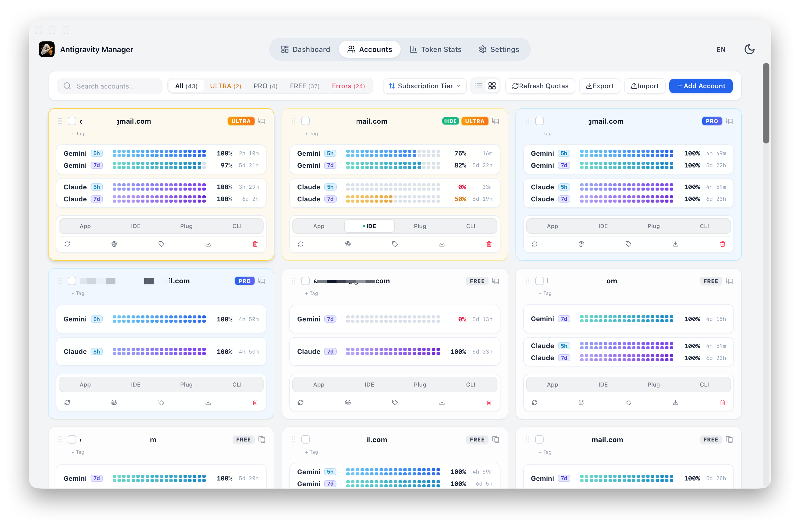<br />
      <sub><b>Bento Card Grid</b> — Color-coded tier cards, active host badges, dual-pool countdowns &amp; quick action dock.</sub>
    </td>
    <td width="50%" align="center">
      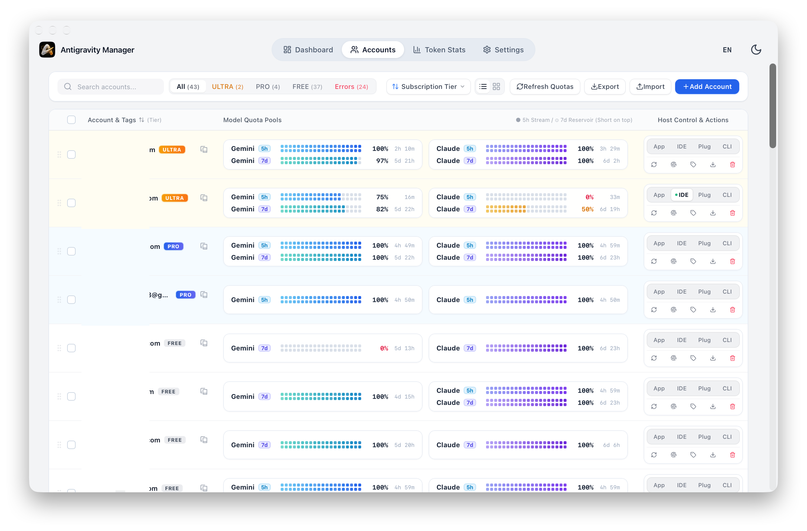<br />
      <sub><b>High-Density Table</b> — Side-by-side <code>5h Stream / 7d Reservoir</code> quota comparison for large account pools.</sub>
    </td>
  </tr>
</table>

### 2. Zero-Proxy Token Stats &amp; Multi-Dimensional Deep Dive

Explore token consumption, prompt cache efficiency, generation throughput (`tok/s`), and agent tool invocations across **Overview**, **Projects**, **Models**, and **Real-Time Ledger** perspectives.

<table>
  <tr>
    <td width="50%" align="center">
      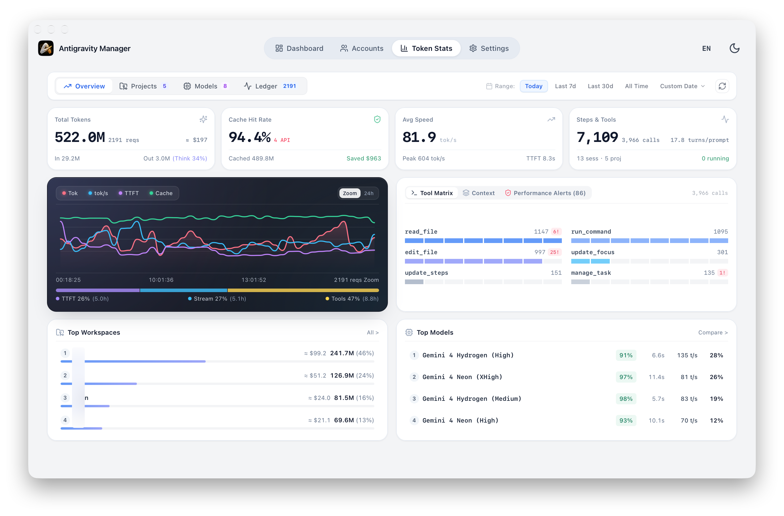<br />
      <sub><b>Global Overview</b> — 24h Telemetry Spectrum, Tool Matrix (<code>read_file</code>, <code>edit_file</code>, <code>run_command</code>) &amp; Top Workspaces/Models.</sub>
    </td>
    <td width="50%" align="center">
      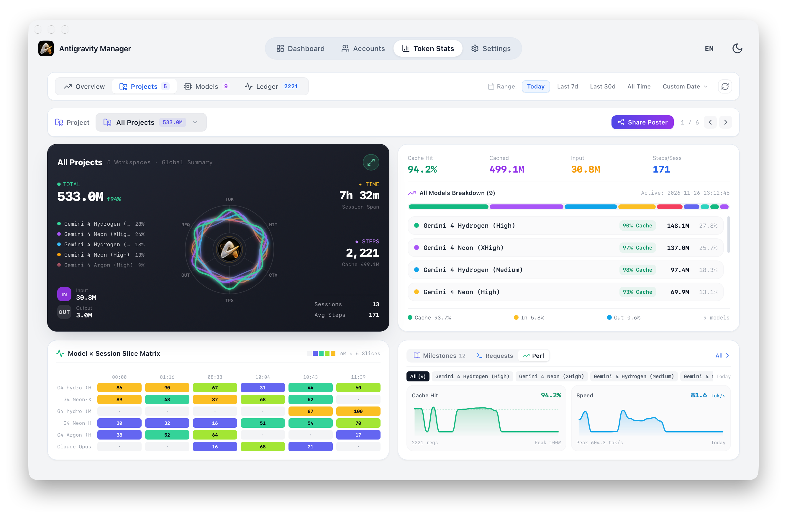<br />
      <sub><b>Workspace Deep-Dive</b> — 6-Axis Radar summary, model cache breakdown, and <code>Model × Session</code> heatmap matrix.</sub>
    </td>
  </tr>
  <tr>
    <td width="50%" align="center">
      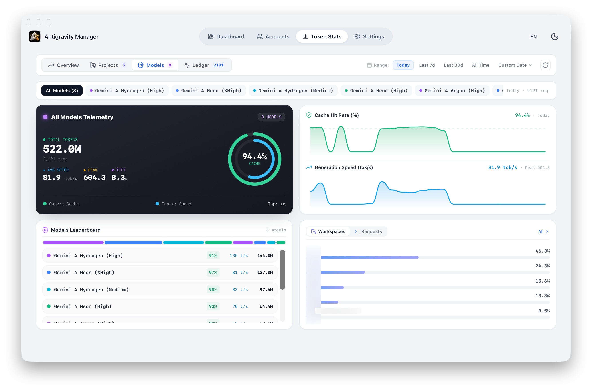<br />
      <sub><b>Model Leaderboard</b> — Dual-ring Cache/Speed gauge with historical Cache Hit Rate (%) &amp; Generation Speed (<code>tok/s</code>) curves.</sub>
    </td>
    <td width="50%" align="center">
      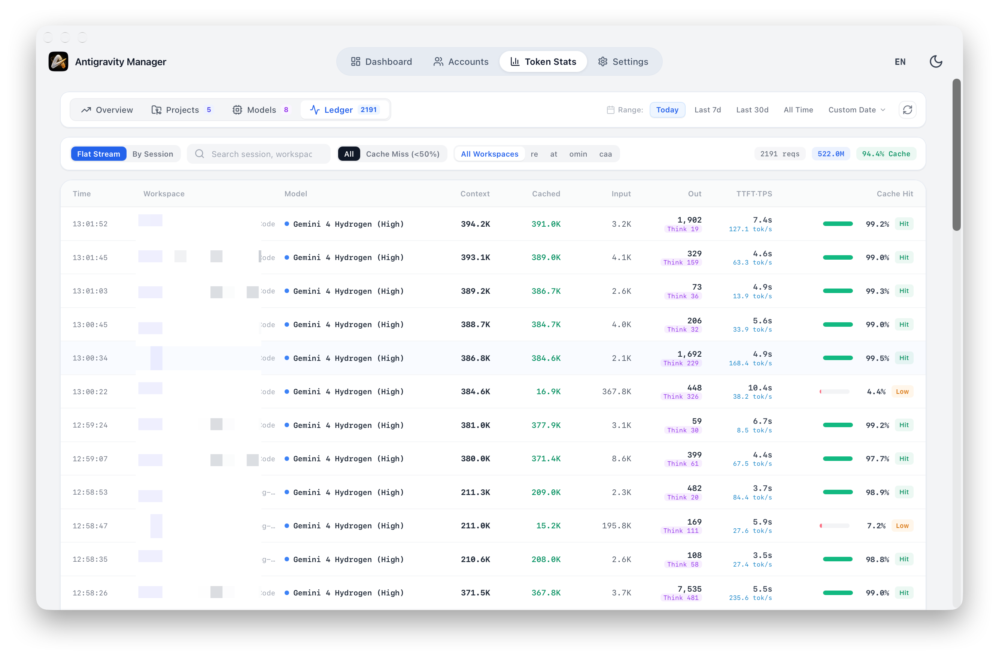<br />
      <sub><b>Real-Time Request Ledger</b> — Per-step inspection of Context window, Cached tokens, Thinking tokens, TTFT·TPS, and Cache Miss filtering.</sub>
    </td>
  </tr>
</table>

### 3. One-Click `16:9` HD Telemetry Share Posters

Generate clean, dark-mode `1280×720` PNG summary cards in four distinct visual themes — ready to copy to clipboard or download in one click.

<table>
  <tr>
    <td width="50%" align="center">
      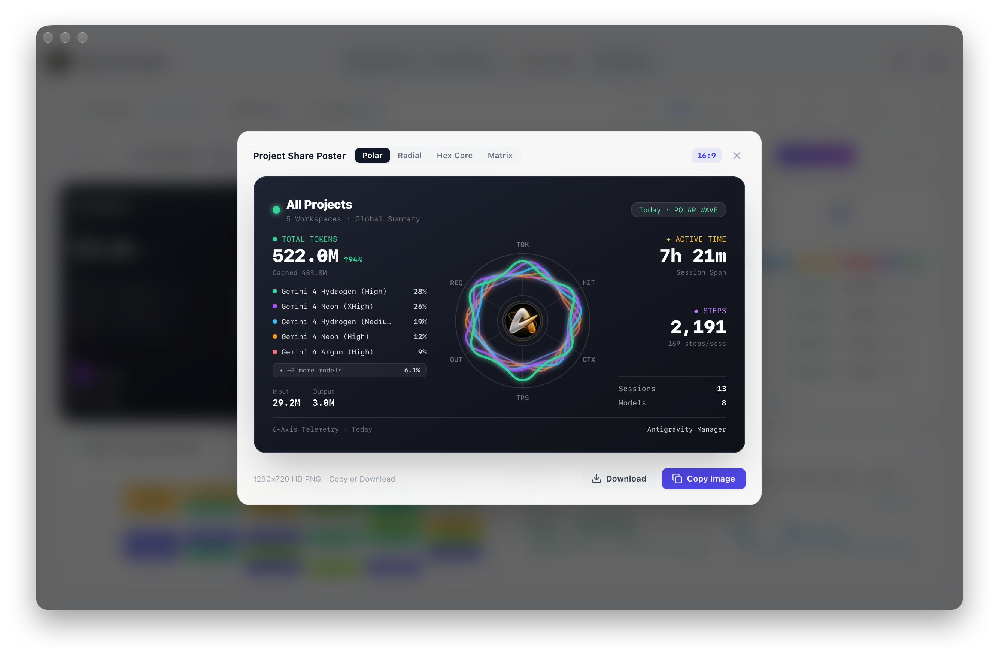<br />
      <sub><b>Polar Wave</b> — 6-Axis Orbital Telemetry</sub>
    </td>
    <td width="50%" align="center">
      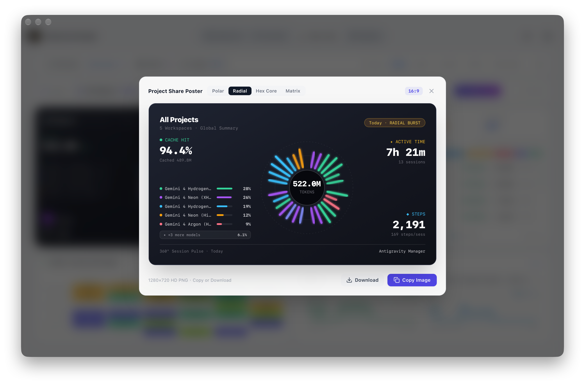<br />
      <sub><b>Radial Burst</b> — 360° Session Pulse</sub>
    </td>
  </tr>
  <tr>
    <td width="50%" align="center">
      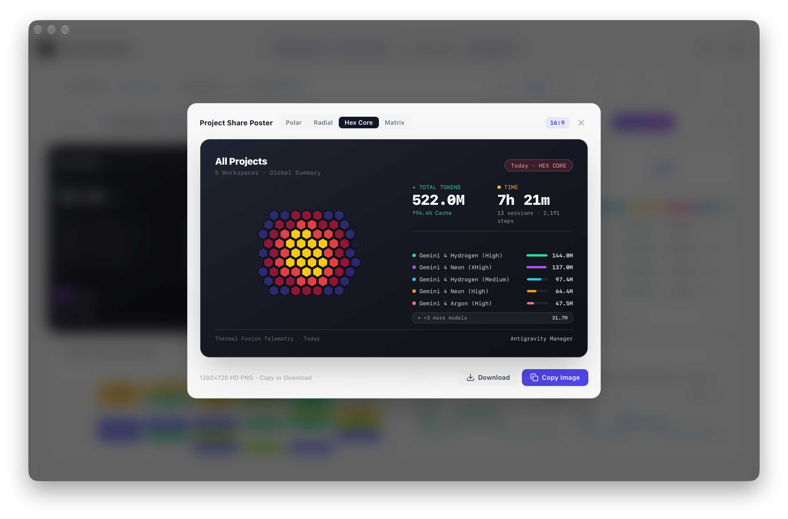<br />
      <sub><b>Hex Core</b> — Thermal Fusion Honeycomb</sub>
    </td>
    <td width="50%" align="center">
      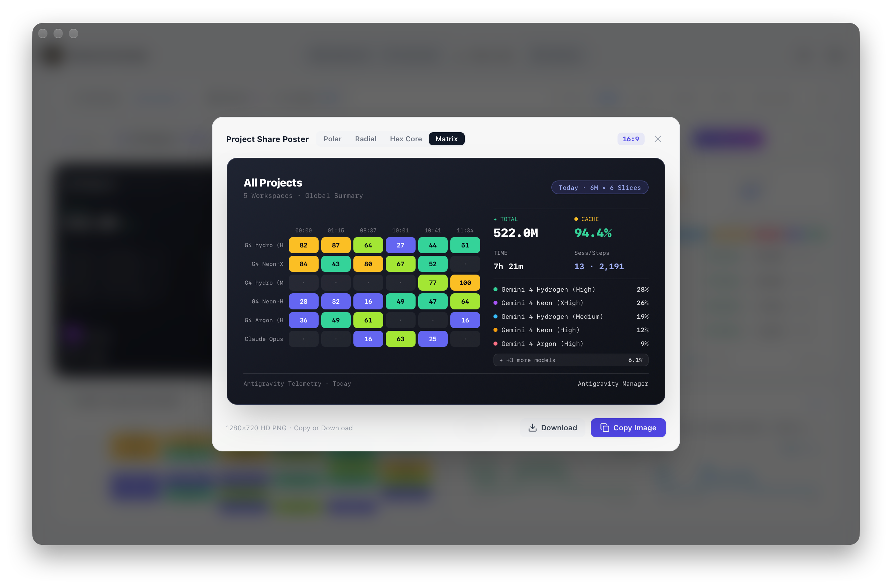<br />
      <sub><b>Slice Matrix</b> — 6M × 6 Session Heatmap</sub>
    </td>
  </tr>
</table>

### 4. Daemon Preferences, Built-in CLI Matrix &amp; Local Storage

<table>
  <tr>
    <td width="33.3%" align="center">
      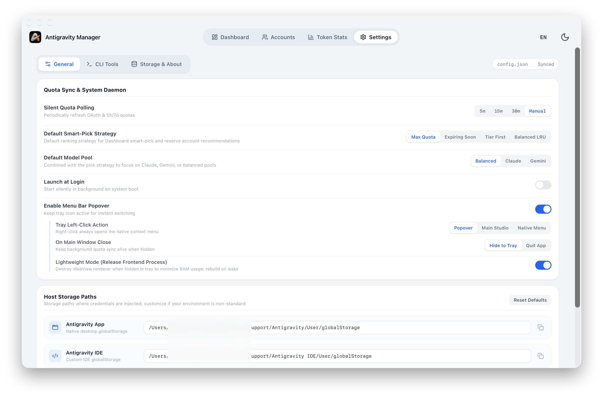<br />
      <sub><b>Daemon &amp; Host Paths</b> — Silent polling, smart-pick defaults, tray behavior, Lightweight Mode &amp; custom <code>globalStorage</code> paths.</sub>
    </td>
    <td width="33.3%" align="center">
      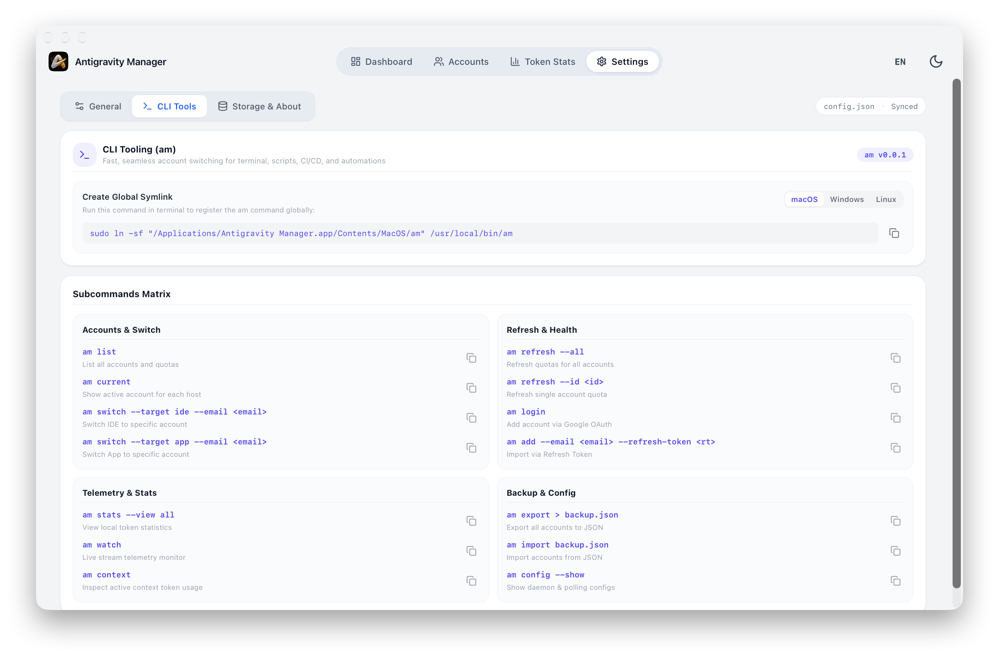<br />
      <sub><b>CLI Tooling (<code>am</code>)</b> — 1-click global symlink registration and interactive subcommand quick-copy matrix.</sub>
    </td>
    <td width="33.3%" align="center">
      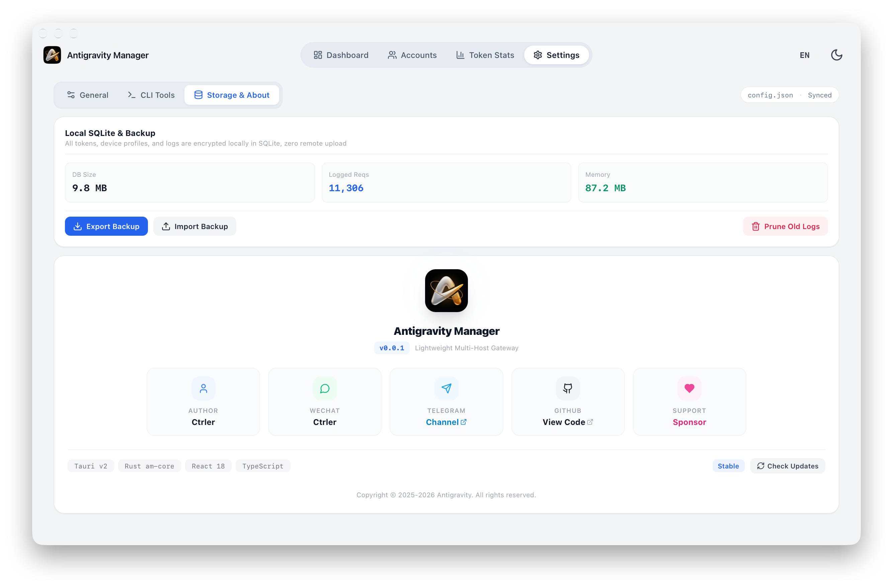<br />
      <sub><b>Storage &amp; Updates</b> — Local SQLite footprint, portable JSON backup/restore, log pruning &amp; in-app update checker.</sub>
    </td>
  </tr>
</table>

---

## 📦 Installation &amp; macOS Gatekeeper Fix

### 1. Pre-built Packages &amp; Homebrew (Recommended)

#### Option A: Direct Download
Download the latest **Antigravity Manager** package from the dedicated **[`antigravity-manager` Release Page](https://github.com/lbjlaq/Antigravity-Manager/releases/tag/antigravity-manager)**:

- **macOS**: Universal / Apple Silicon (`aarch64`) / Intel (`x86_64`) `.dmg`
- **Windows**: `.msi` or NSIS `-setup.exe` (`x64`)
- **Linux**: `.deb` / `.rpm` / `.AppImage` (`x86_64` &amp; `arm64`)

#### Option B: Homebrew (macOS &amp; Linuxbrew — Auto-clears macOS Quarantine + Links `am` CLI)

```bash
brew tap lbjlaq/antigravity-manager https://github.com/lbjlaq/Antigravity-Manager
brew install --cask antigravity-manager
```

> To upgrade later: `brew upgrade --cask --greedy antigravity-manager` (or use the built-in one-click updater inside **Settings → Storage &amp; About**).

### 2. 🛠️ macOS Says *"Antigravity Manager is damaged and can't be opened"*?

Because non-App Store builds carry macOS Gatekeeper's `com.apple.quarantine` attribute after browser download, macOS may falsely prompt **"App is damaged and can't be opened. You should move it to the Trash"** or **"Unidentified developer"**.

Run this single command in Terminal after dragging the app into `/Applications` to clear the quarantine flag immediately:

```bash
sudo xattr -rd com.apple.quarantine "/Applications/Antigravity Manager.app"
```

> Alternatively, open **System Settings → Privacy &amp; Security**, scroll down to the security prompt for **Antigravity Manager**, and click **Open Anyway**.

<details>
<summary><b>🔧 More Platform Troubleshooting (Linux Wayland / OAuth Callback) — Click to expand</b></summary>

#### Linux window appears black or blank on Wayland compositors (Hyprland / Sway / niri)?
On certain Wayland compositors, WebKitGTK's DMA-BUF renderer can render a blank frame. Launch with:

```bash
env WEBKIT_DISABLE_DMABUF_RENDERER=1 am-gui
```

#### Browser shows `localhost refused connection` during Google OAuth login?
Each OAuth flow binds a one-time ephemeral local callback port. Always copy/open the **latest** authorization URL while the login dialog (or `am login`) is actively running; for headless/remote machines without a local browser, use `am login --manual` and paste the callback code/URL directly.

</details>

### 3. Build from Source (`antigravity-manager` Branch)

**Prerequisites**: Rust (`stable`), Node.js (`>= 20`), and platform Tauri v2 dependencies.

```bash
# Clone the antigravity-manager branch directly
git clone -b antigravity-manager --single-branch https://github.com/lbjlaq/Antigravity-Manager.git
cd Antigravity-Manager

# Option A: Build standalone CLI (`am`) only
cargo build --release -p am-cli
./target/release/am --help

# Option B: Build full Desktop GUI (with bundled `am` CLI sidecar)
node scripts/prepare-sidecar.mjs
cd crates/am-gui/ui
npm install
npm run build

cd ../src-tauri
cargo tauri build
```

---

## 🛠 CLI Tooling (`am`)

Antigravity Manager includes a native cross-platform Rust CLI (`am` / `am.exe`) sharing the exact same `am-core` database, device fingerprint profiles, and zero-proxy host switcher as the GUI.

### Register Global `am` Command (`macOS` · `Windows` · `Linux`)

```bash
# macOS (.dmg / .app bundle)
sudo ln -sf "/Applications/Antigravity Manager.app/Contents/MacOS/am" /usr/local/bin/am

# Linux (standalone binary or extracted bundle)
sudo install -Dm755 ./am /usr/local/bin/am

# Cross-Platform from source (installs to ~/.cargo/bin/am or %USERPROFILE%\.cargo\bin\am.exe)
cargo install --path crates/am-cli
```

```powershell
# Windows (PowerShell — add install directory to user PATH)
$d = "$env:LOCALAPPDATA\Antigravity Manager"
$p = [Environment]::GetEnvironmentVariable("Path", "User")
if ($p -notlike "*$d*") { [Environment]::SetEnvironmentVariable("Path", $(if ($p) { "$p;$d" } else { $d }), "User") }
```

### Quick-Start Examples

```bash
# 1. Inspect Accounts & Active Host Bindings
am list                                           # List all accounts & Gemini/Claude 5h/7d pools (alias: am ls)
am list --healthy --tag work --sort quota         # Filter healthy accounts by tag, sorted by remaining quota
am current                                        # Show active account on App, IDE, ACP Plugin & CLI (alias: am whoami)

# 2. Hot-Switch Specific Host or All Hosts at Once
am switch user@gmail.com --target ide             # Switch Antigravity IDE by email, prefix, or ID (alias: am use)
am switch user@gmail.com --target app --restart   # Switch Desktop App and force clean host restart
am switch --auto --target all --prefer claude     # Smart-pick best account across all 4 hosts preferring Claude pool
am switch --auto --target cli --strategy least-used --tag pro

# 3. OAuth Login (Desktop & Headless SSH), Quota Sync & Tags
am login                                          # Local browser OAuth callback flow
am login --manual                                 # Headless / SSH mode: print auth URL & paste code manually
am add --token "<refresh_token>" --tags pro,team  # Add account directly via OAuth Refresh Token
am refresh                                        # Refresh quotas for all accounts (alias: am sync)
am tag user@gmail.com add vip,claude              # Manage account tags (add | remove | set | ls)

# 4. Zero-Proxy Local Telemetry & Real-Time Stream Monitor
am stats --view all --range today                 # Terminal analytics (--view all|account|model|app|timeline)
am stats --view model --range 7d --json           # Export 7-day model telemetry as JSON for scripts
am watch --interval 2                             # Live real-time TPS & token generation monitor
am context                                        # Inspect active conversation context window & cache health

# 5. Fingerprint Isolation, Account Recovery, Daemon Config & Diagnostics
am fingerprint                                    # Check active host fingerprint vs account profile alignment
am device-reset user@gmail.com                    # Regenerate isolated hardware fingerprint for an account
am unblock user@gmail.com                         # Clear 403 / validation lock state on an account
am config --show                                  # Inspect daemon, polling, tray & lightweight mode settings
am config --auto-switch on --quota-polling on --interval-minutes 15 --lightweight on
am export -o backup.json                          # Export portable account backup JSON
am import backup.json --overwrite                 # Import accounts from backup JSON
am doctor                                         # Diagnose host installations, SQLite DB & storage paths
am update                                         # Check for updates on the antigravity-manager release channel
```

<details>
<summary><b>📖 Complete <code>am</code> Subcommands Reference Table (22 Commands) — Click to expand</b></summary>

| Command | Alias | Key Flags / Arguments | Description |
| :--- | :---: | :--- | :--- |
| `am list` | `ls` | `--tag`, `--healthy`, `--sort`, `--json` | List all accounts with `5h/7d` Gemini &amp; Claude quota pools (`--sort quota\|priority\|last-used\|recent\|created\|email`). |
| `am current` | `whoami` | — | Display currently active accounts across `App`, `IDE`, `ACP Plugin`, and `CLI`. |
| `am switch [acc]` | `use` | `-t/--target`, `--auto`, `--strategy`, `--prefer`, `--tag`, `--restart` | Switch account for `ide`, `app`, `plugin`, `cli`, or `all` (`--strategy max-quota\|least-used\|priority\|random`). |
| `am login` | — | `-m/--manual` | Add account via official Google OAuth (`--manual` for headless/SSH servers). |
| `am add` | — | `-t/--token <rt>`, `--tags a,b` | Add account directly using an existing Google OAuth Refresh Token. |
| `am refresh [acc]` | `sync` | `[account]` | Refresh quota for a single account or omit argument to sync all accounts. |
| `am tag <acc>` | — | `add` \| `remove` (`rm`) \| `set` \| `list` (`ls`) | Add, remove, overwrite, or list tags on an account. |
| `am disable <acc>` | — | `-r/--reason <text>` | Manually disable an account from smart-pick rotation. |
| `am enable <acc>` | — | — | Re-enable a manually disabled account. |
| `am unblock <acc>` | — | — | Clear `403` / validation lock status on an account. |
| `am delete <acc...>` | `rm` | `<id_or_email...>` | Delete one or multiple accounts from local storage. |
| `am reorder <ids...>` | — | `<id1> <id2> ...` | Persist custom account ordering by ID sequence. |
| `am fingerprint` | — | — | Inspect active host client device fingerprint and local/remote alignment. |
| `am device-reset <acc>` | — | — | Regenerate and bind a fresh isolated device profile for an account. |
| `am stats` | — | `-v/--view`, `-r/--range`, `--date`, `--json` | Local token telemetry across `all`, `account`, `model`, `app`, or `timeline` (`today\|7d\|30d\|all`). |
| `am context` | — | — | Inspect active conversation context window breakdown &amp; cache health. |
| `am watch` | — | `-i/--interval <secs>` | Real-time live TPS &amp; telemetry monitor for the active host. |
| `am config` | — | `--show`, `--auto-switch`, `--quota-polling`, `--interval-minutes`, `--tray`, `--tray-click`, `--close-to-tray`, `--quiet-autostart`, `--lightweight` | Read or update daemon, polling, system tray, and WebView lightweight settings from CLI. |
| `am export` | — | `-o/--output <path>` | Export all accounts into a portable JSON backup file. |
| `am import <file>` | — | `-o/--overwrite` | Import accounts from a JSON backup file. |
| `am update` | — | — | Check the `antigravity-manager` release channel for newer versions. |
| `am doctor` | — | — | Inspect system diagnostics, SQLite health, and 4-host installation paths. |

</details>

---

## 🏗 Architecture

Built as a modular Rust workspace decoupling core domain logic (`am-core`) from presentation layers (`am-gui` &amp; `am-cli`):

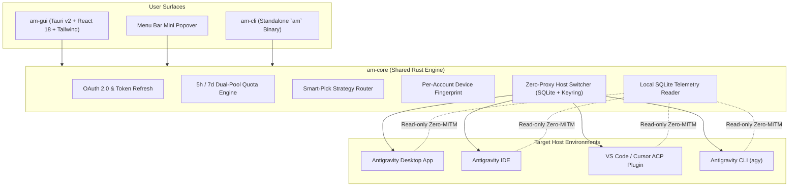

```text
Antigravity-Manager/           # (Branch: antigravity-manager)
├── crates/
│   ├── am-core/               # Core Rust library: OAuth, 5h/7d quota, smart strategy,
│   │                          # SQLite/Keyring zero-proxy switcher, fingerprint & local stats
│   ├── am-cli/                # Headless CLI binary (`am`) with full 22-command parity
│   └── am-gui/
│       ├── src-tauri/         # Tauri v2 native host, tray popover, updater & IPC bridge
│       └── ui/                # React 18 + TypeScript + Tailwind CSS Bento studio & 12-lang i18n
└── docs/
    ├── GUI_DESIGN.md          # Visual language & component design specification
    └── assets/                # Brand icons, sponsor logos & product screenshots
```

---

## 🚀 Related Ecosystem Projects

- **[Antigravity Tools (`main` branch)](https://github.com/lbjlaq/Antigravity-Manager/tree/main)** — Full-featured AI protocol conversion &amp; multi-account API proxy gateway (OpenAI / Anthropic Claude / Google Gemini endpoints, Docker &amp; headless web console).

---

## 📝 Changelog

Only the latest release highlights are listed below. See **[CHANGELOG.md](CHANGELOG.md)** for full bilingual release history and the **[`antigravity-manager` Release Page](https://github.com/lbjlaq/Antigravity-Manager/releases/tag/antigravity-manager)** for downloadable installers.

- **v0.0.2**: Fixed cross-platform (`macOS` / `Windows` / `Linux`) active account detection across `App` / `IDE` / `ACP` / `CLI` (unified OS Keyring, `app_storage.json`, `state.vscdb` + JWT fallback, Windows `ProgramFiles` &amp; Linux directory/case-variant discovery), added `Active Account` column to `am current`, and localized unbound Dashboard labels.
- **v0.0.1 (`am-core` Workspace Edition)**: Modular `am-core` + `am-cli` + `am-gui` Rust workspace, zero-proxy 4-host credential injection (`App` / `IDE` / `ACP` / `CLI`), `5h`/`7d` Gemini &amp; Claude quota pools, local SQLite telemetry studio, shareable HD `16:9` posters, dual-mode Menu Bar Mini Popover, and bundled cross-platform `am` CLI sidecar.

---

## 🤝 Community &amp; License

- **Author**: **Ctrler** ([@lbjlaq](https://github.com/lbjlaq))
- **Telegram Channel**: [@AntigravityManager](https://t.me/AntigravityManager)
- **WeChat Official Account**: `Ctrler`
- **GitHub Sponsors**: [Sponsor @lbjlaq ❤️](https://github.com/sponsors/lbjlaq)
- **Privacy Guarantee**: All OAuth tokens, hardware fingerprints, and telemetry logs are stored locally in SQLite on your device — zero remote upload.
- **License**: Licensed under **[CC BY-NC-SA 4.0](LICENSE)** — **strictly non-commercial use only**.

<div align="center">
  <p>If Antigravity Manager saves you time, please consider giving the repository a ⭐️</p>
  <p>Copyright © 2024–2026 Antigravity Team. All rights reserved.</p>
</div>
