<div align="center">
  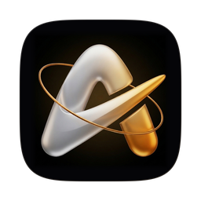

  <h1>Antigravity Manager</h1>

  <p>
    <strong>零反代直连 · 多宿主账号热切、双池配额监控与本地全链路遥测中枢</strong><br />
    <sub>无缝接管 Antigravity 原生桌面端、定制 IDE、ACP 插件与 CLI 命令行 —— 独立硬件指纹隔离、菜单栏灵动弹窗、零 MITM 本地 SQLite 实时 Token 洞察。</sub>
  </p>

  <p>
    <a href="https://raw.githack.com/lbjlaq/Antigravity-Manager/antigravity-manager/docs/index.html"></a>
    <a href="https://github.com/lbjlaq/Antigravity-Manager/releases/tag/antigravity-manager"></a>
    <a href="https://github.com/lbjlaq/Antigravity-Manager/tree/antigravity-manager"></a>
    
    
    
    <a href="https://t.me/AntigravityManager"></a>
    <a href="https://github.com/sponsors/lbjlaq"></a>
    <a href="LICENSE"></a>
  </p>

  <p>
    <a href="https://trendshift.io/repositories/18224?utm_source=repository-badge&utm_medium=badge&utm_campaign=badge-repository-18224" target="_blank" rel="noopener noreferrer">
      
    </a>
  </p>

  <p>
    <a href="./README.md">English</a> · <strong>简体中文</strong>
    &nbsp;&nbsp;|&nbsp;&nbsp;
    <a href="#-赞助商-sponsors">赞助支持</a> ·
    <a href="#-核心特性">核心特性</a> ·
    <a href="#-界面一览">界面一览</a> ·
    <a href="#-安装指南与-macos-损坏修复">安装与修复</a> ·
    <a href="#-命令行工具全集-am">CLI (<code>am</code>)</a> ·
    <a href="#-系统架构">系统架构</a>
  </p>

  <br />

  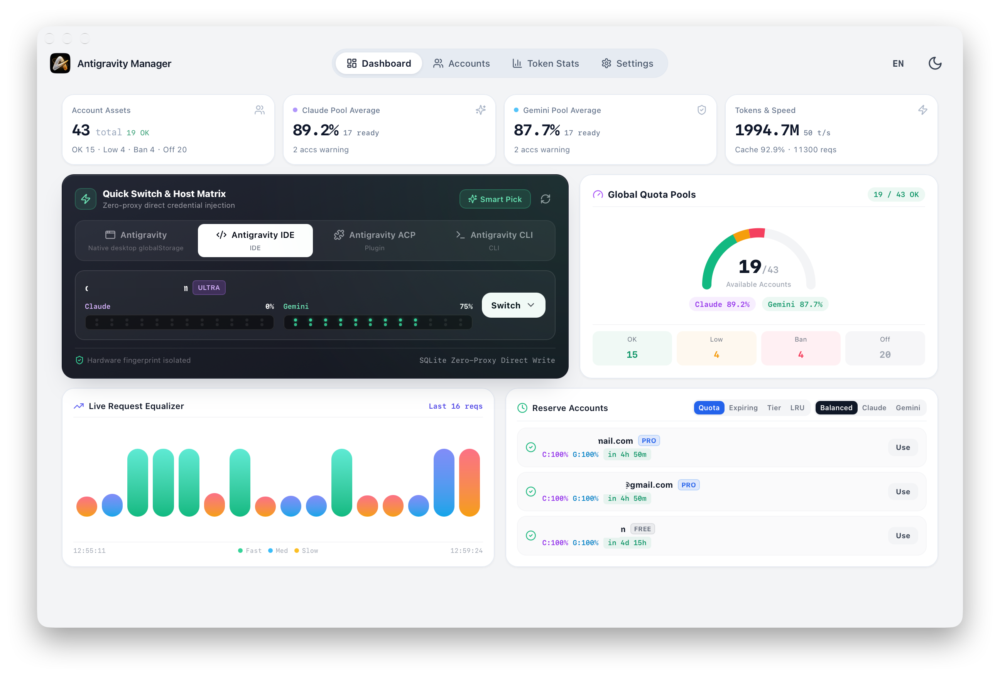
</div>

> [!NOTE]
> **分支与版本选型指引（`antigravity-manager` 分支 vs `main` 主分支）**
> - **当前分支（[`antigravity-manager`](https://github.com/lbjlaq/Antigravity-Manager/tree/antigravity-manager)）**：**Antigravity Manager（纯净零反代直连版）** —— 专注多宿主无感切号、双池配额监控、本地 SQLite 全链路遥测与 `am` 终端工具，安装包独立发布于 **[`antigravity-manager` 专属 Release 页面](https://github.com/lbjlaq/Antigravity-Manager/releases/tag/antigravity-manager)**（与主分支 `releases/latest` 完全隔离）。
> - **仓库主分支（[`main`](https://github.com/lbjlaq/Antigravity-Manager/tree/main)）**：**Antigravity Tools（全功能协议反代网关版）** —— 提供 OpenAI / Anthropic Claude / Gemini 多协议本地 API 中转站、模型路由与 Docker/Headless 部署。
> - **数据互通免冲突**：两个版本底层共用 `~/.antigravity_tools/` 账号池目录，支持同机并存、数据实时互通。

---

## 💖 赞助商 (Sponsors)

| 赞助商 (Sponsor) | 简介 (Description) |
| :---: | :--- |
|  | 感谢 **PackyCode** 对本项目的赞助！PackyCode 是一家可靠高效的 API 中转服务商，提供 Claude Code、Codex、Gemini 等多种服务的中转。PackyCode 为本项目的用户提供了特别优惠：使用[此链接](https://www.packyapi.com/register?aff=Ctrler)注册，并在充值时输入 **“Ctrler”** 优惠码即可享受 **九折优惠**。 |
| 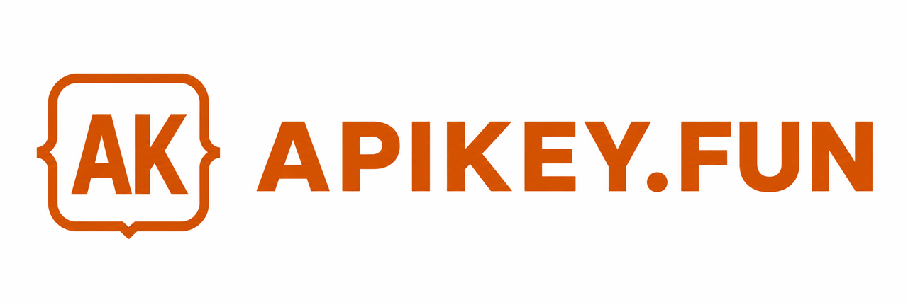 | 感谢 **APIKEY.FUN** 赞助本项目！APIKEY.FUN 是一家专业的企业级 AI 中转站，致力于为企业和个人开发者提供稳定、高效、低成本的 AI 模型 API 接入服务。平台支持 Claude、OpenAI、Gemini 等主流热门模型，价格低至官方原价的 7%。通过本项目[专属链接](https://apikey.fan/register?aff=AntManager)注册，还可享受最高 **充值永久 95 折** 专属优惠。 |
|  | 感谢 **Claude API** 对本项目的支持！claudeapi.com 是一家走**官方与 AWS 渠道**接入的 **Claude API** 中转站，专注 Claude，主打高稳定、低延迟，完整支持 Claude Code。为本项目用户提供专属福利：通过[专属链接](https://console.claudeapi.com/register?source=antigravity)注册即送**免费测试额度，零门槛跑通**；充值再享 **95 折**专属优惠（联系客服）。 |
| 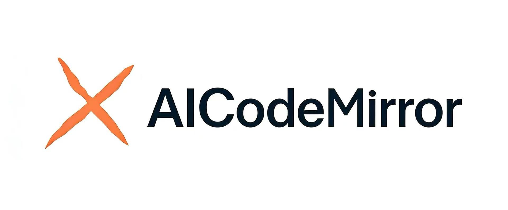 | 感谢 **AICodeMirror** 赞助了本项目！AICodeMirror 提供 Claude Code / Codex / Gemini CLI 官方高稳定中转服务，支持企业级高并发、极速开票、7×24 专属技术支持。Claude Code / Codex / Gemini 官方渠道低至 3.8 / 0.2 / 0.9 折，充值更有折上折！通过[此链接](https://aicodemirror.ai/register?invitecode=MV5XUM)注册的用户，可享受**首充 8 折**，企业客户最高可享 **7.5 折**！ |

### ☕ 支持项目 (Support)

如果您觉得 **Antigravity Manager** 对您的日常开发有所帮助，欢迎通过 [GitHub Sponsors](https://github.com/sponsors/lbjlaq) 或扫码请作者喝杯咖啡。希望将您的个人头像或品牌 Logo 展示在本项目 README？欢迎在 GitHub Sponsors 选择 **README Backer（$25/月）** 或 **Silver Sponsor（$150/月）** 档位：

<p align="center">
  <a href="https://github.com/sponsors/lbjlaq" target="_blank" rel="noopener noreferrer">
    
  </a>
  &nbsp;&nbsp;
  <a href="https://www.buymeacoffee.com/Ctrler" target="_blank" rel="noopener noreferrer">
    
  </a>
</p>

<table>
  <tr>
    <td align="center" width="33.3%">
      <br />
      <sub><b>支付宝 (Alipay)</b></sub>
    </td>
    <td align="center" width="33.3%">
      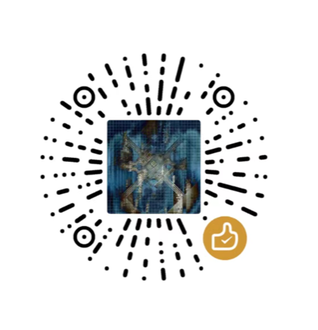<br />
      <sub><b>微信支付 (WeChat)</b></sub>
    </td>
    <td align="center" width="33.3%">
      <br />
      <sub><b>Buy Me a Coffee</b></sub>
    </td>
  </tr>
</table>

---

## ✨ 核心特性

- ⚡ **零反代直写热切换 (`Zero-Proxy Direct Write`)** — 摒弃本地反向代理与 TLS 中间人劫持，无额外网络转发延迟与网关特征暴露风险；底层采用现代化 Protobuf Sentinel 编码直写宿主 `globalStorage` (`state.vscdb`) 与系统密钥链（macOS `Keychain` / Windows `CredWriteW` / Linux `Secret Service`），实现毫秒级无感切号。
- 🎯 **四宿主矩阵独立调度 (`App · IDE · ACP · CLI`)** — 支持对 **Antigravity 原生桌面端**、**Antigravity 定制版 IDE**、**VS Code / Cursor ACP 插件** 及 **`agy` 命令行工具** 进行独立或全局一键切号，多端并行互不干扰。
- 🔋 **双窗口配额池监控 (`5h 实时流` + `7d 周期池`)** — 实时追踪 **Gemini** 与 **Claude** 两大模型池的 `5h` 短窗与 `7d` 周度余量、重置倒计时及订阅等级（`ULTRA` / `PRO` / `FREE`），内置 `Smart Pick` 智能选号策略（最大余量、优先消耗临期、高阶订阅优先、均衡 LRU）。
- 🛡️ **硬件级设备指纹隔离** — 为每个账号独立生成、绑定并持久化专属设备特征指纹（Device Profile），在切号时同步注入宿主环境，规避多号轮换关联风控。
- 📊 **本地 SQLite 全链路遥测与高清海报分享** — 零抓包直读本地遥测库，深度剖析总 Token、Prompt Cache 命中率、首字延迟（TTFT）与生成速率（`tok/s`）、Agent 工具调用矩阵及实时请求流水账；支持一键生成 4 款 `1280×720` 高清暗黑战报海报（`Polar`、`Radial`、`Hex Core`、`Matrix`）。
- 🪟 **菜单栏 Mini 灵动弹窗与极速轻量模式** — 常驻系统托盘 / 菜单栏，一键切换「四宿主快切」与「今日实时 Token 脉搏」双视图；开启**轻量模式（Lightweight Mode）**后隐藏至托盘即自动销毁 WebView 渲染进程，后台常驻内存极致精简。
- 💻 **全功能无头 CLI (`am`)** — 基于统一 `am-core` Rust 内核构建独立命令行工具 `am`，提供 22 个完备子命令，完美覆盖 SSH 远程服务器、自动化脚本与终端极客工作流。
- 🌍 **12 国语言与 100% 本地隐私安全** — 内置简/繁中文、英、日、韩、俄、西、葡、土、越、阿、马来语 12 种语言热切换；所有凭证、设备指纹与遥测日志均保存在本地 SQLite，零云端上传。

---

## 🪟 菜单栏灵动悬浮窗 (Mini Popover)

常驻系统顶部菜单栏 / 托盘，无需切出当前编码窗口，即可在 **四宿主智能快切** 与 **今日实时遥测看板** 之间无缝切换：

<table>
  <tr>
    <td width="50%" align="center">
      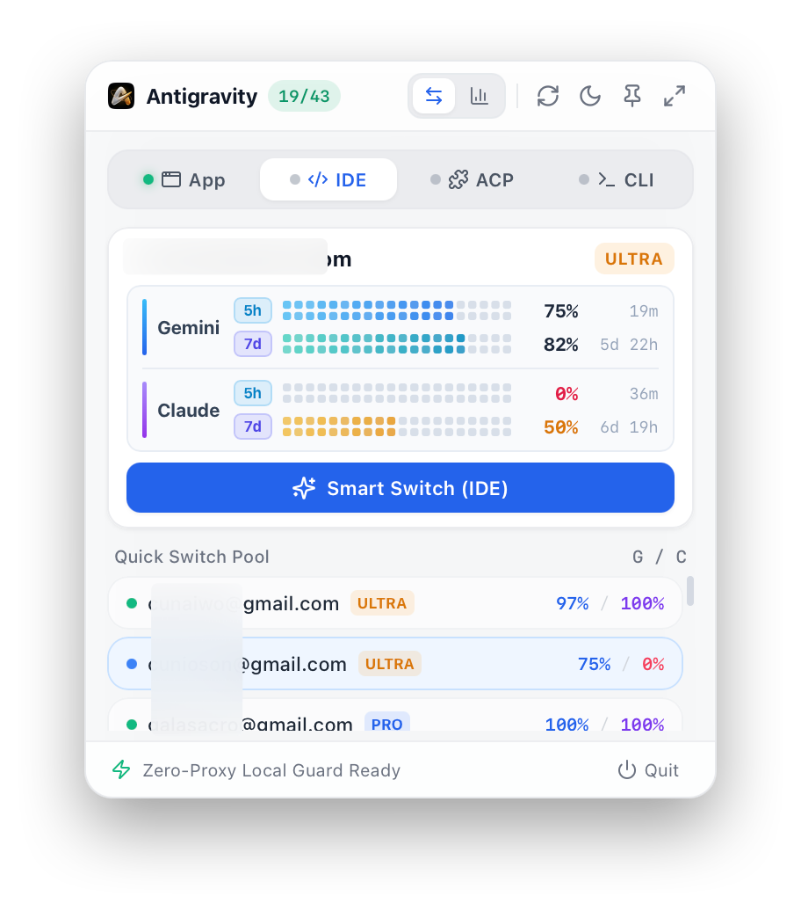<br />
      <sub><b>快切模式 (Quick Switch)</b> — 四宿主在线状态灯（<code>App · IDE · ACP · CLI</code>）、当前账号双池水位、一键 <code>Smart Switch</code> 与备选号池快切。</sub>
    </td>
    <td width="50%" align="center">
      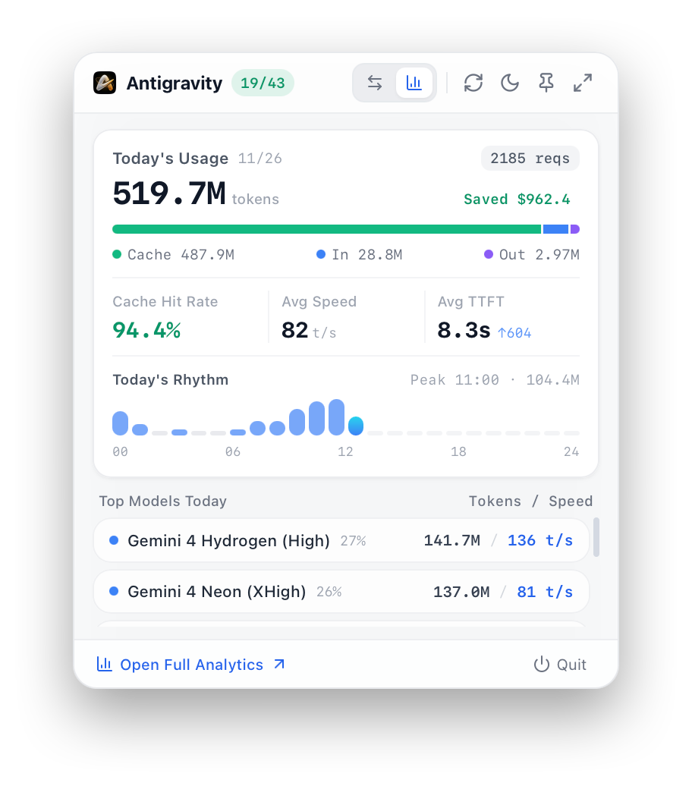<br />
      <sub><b>遥测模式 (Live Telemetry)</b> — 今日累计 Token、缓存节省估算、命中率、平均生成速率与 TTFT、24 小时负载节律及主力模型排行。</sub>
    </td>
  </tr>
</table>

---

## 🎨 界面一览

### 1. 多账号资产池与宿主精准派发（卡片网格 &amp; 高密列表双视图）

支持按订阅等级（`ULTRA` / `PRO` / `FREE` / `异常`）筛选、自定义标签管理、`5h / 7d` 双池点阵进度条对比，并可在任意账号卡片上一键将其派发至 `App`、`IDE`、`Plug` 或 `CLI`。

<table>
  <tr>
    <td width="50%" align="center">
      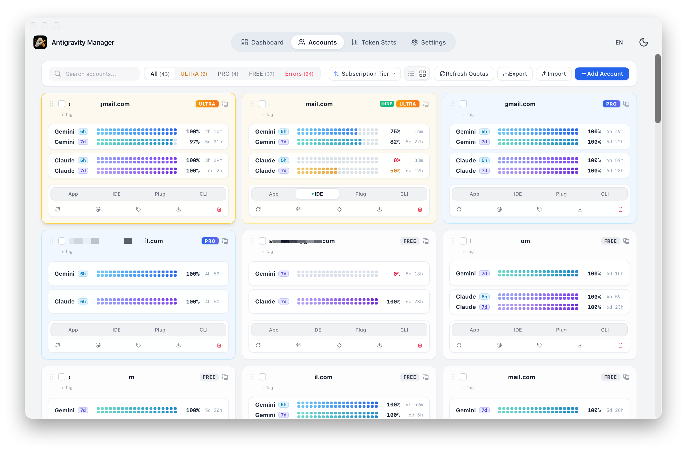<br />
      <sub><b>Bento 卡片网格视图</b> — 订阅等级色阶边框、活跃宿主角标、双池重置倒计时与底部五合一快捷操作坞。</sub>
    </td>
    <td width="50%" align="center">
      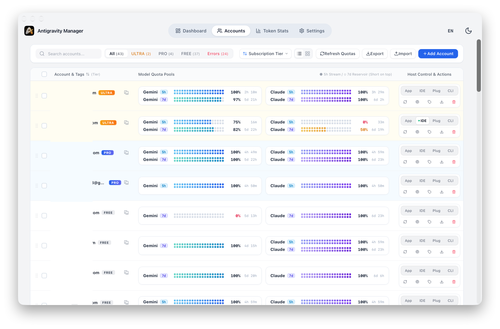<br />
      <sub><b>高密度列表视图</b> — 并排展示 <code>5h Stream / 7d Reservoir</code> 点阵配额，轻松驾驭数十上百个账号池。</sub>
    </td>
  </tr>
</table>

### 2. 零反代 Token 统计洞察与三维下钻分析

从 **全局总览（Overview）**、**工作区项目（Projects）**、**模型榜单（Models）** 到 **实时请求台账（Ledger）** 四大维度，全方位透视 AI 编码吞吐效率与缓存健康度。

<table>
  <tr>
    <td width="50%" align="center">
      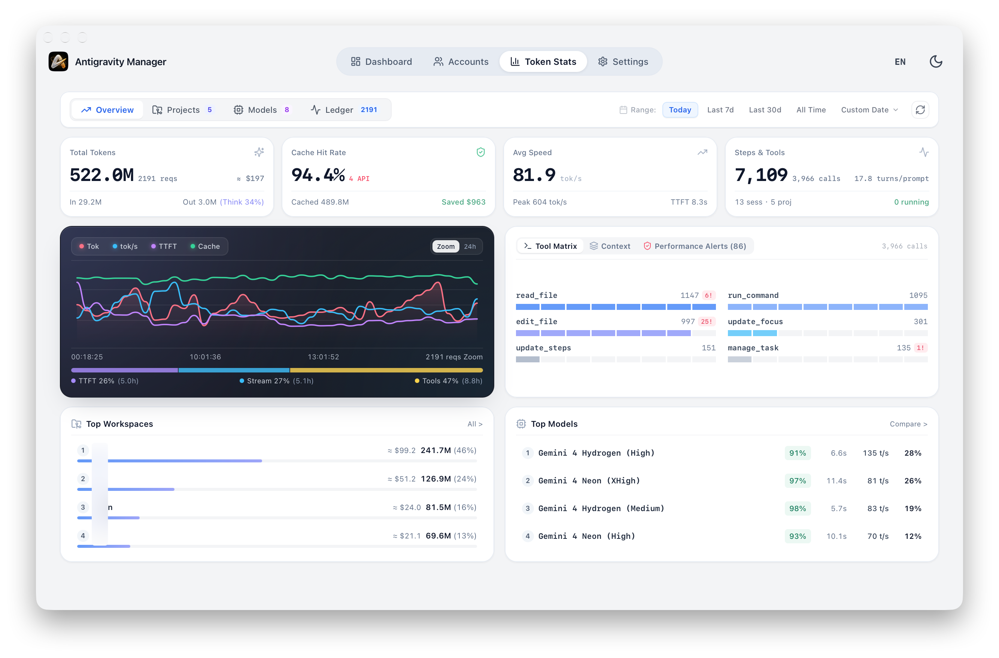<br />
      <sub><b>全局遥测光谱</b> — 24h 多维趋势曲线、Agent 工具调用矩阵（<code>read_file</code>、<code>edit_file</code>、<code>run_command</code>）与主力项目/模型排行。</sub>
    </td>
    <td width="50%" align="center">
      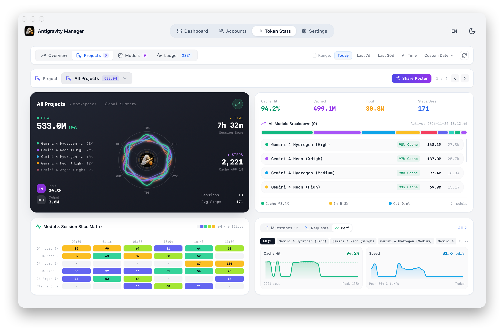<br />
      <sub><b>项目工作区深潜</b> — 六轴能力雷达图、模型缓存拆解及 <code>模型 × 会话切片</code> 热力矩阵。</sub>
    </td>
  </tr>
  <tr>
    <td width="50%" align="center">
      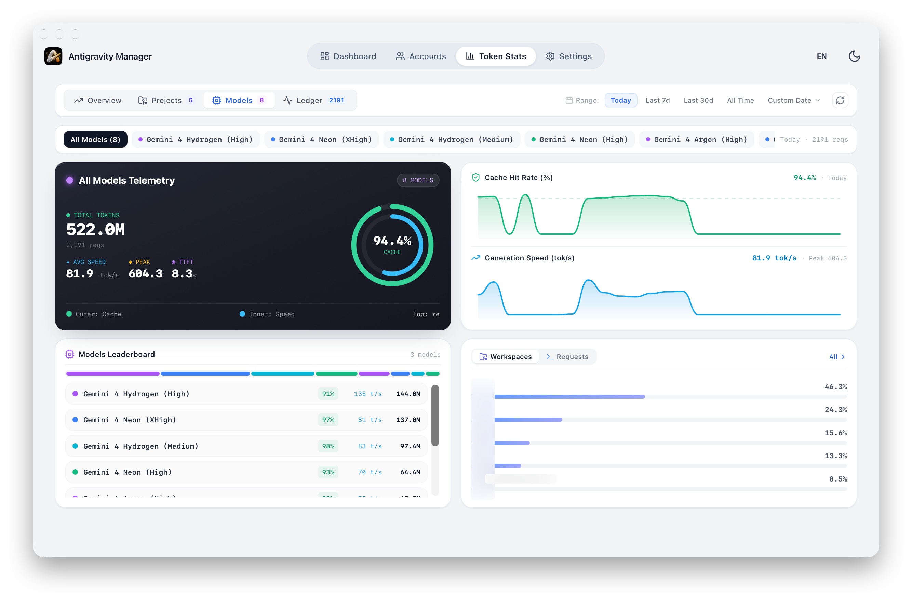<br />
      <sub><b>模型遥测天梯</b> — 缓存率 / 吞吐速率双环仪表，搭配各模型实时命中率与生成速度曲线。</sub>
    </td>
    <td width="50%" align="center">
      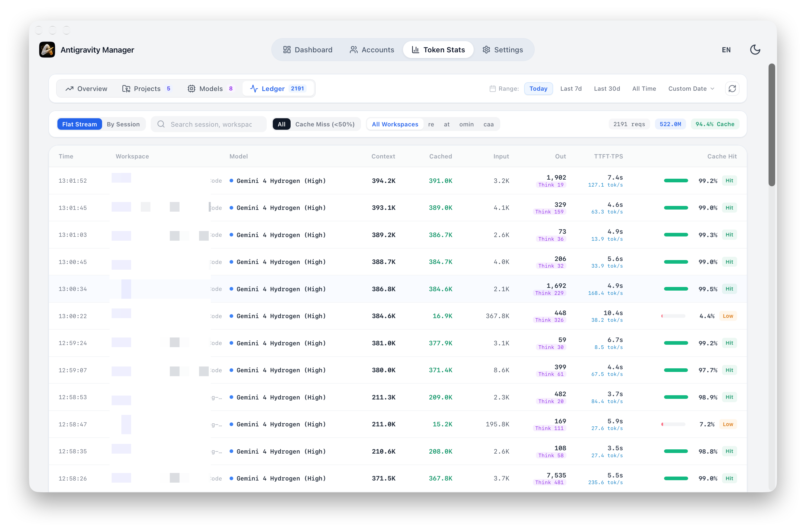<br />
      <sub><b>实时请求台账 (Ledger)</b> — 逐笔追踪上下文窗口体积、缓存命中、Thinking 思考开销、TTFT·TPS，支持一键定位低命中率请求。</sub>
    </td>
  </tr>
</table>

### 3. 一键生成 `16:9` 高清遥测战报海报 (Share Poster)

内置 4 套赛博暗黑数据可视化主题，支持一键复制 `1280×720` 高清 PNG 至剪贴板或下载保存：

<table>
  <tr>
    <td width="50%" align="center">
      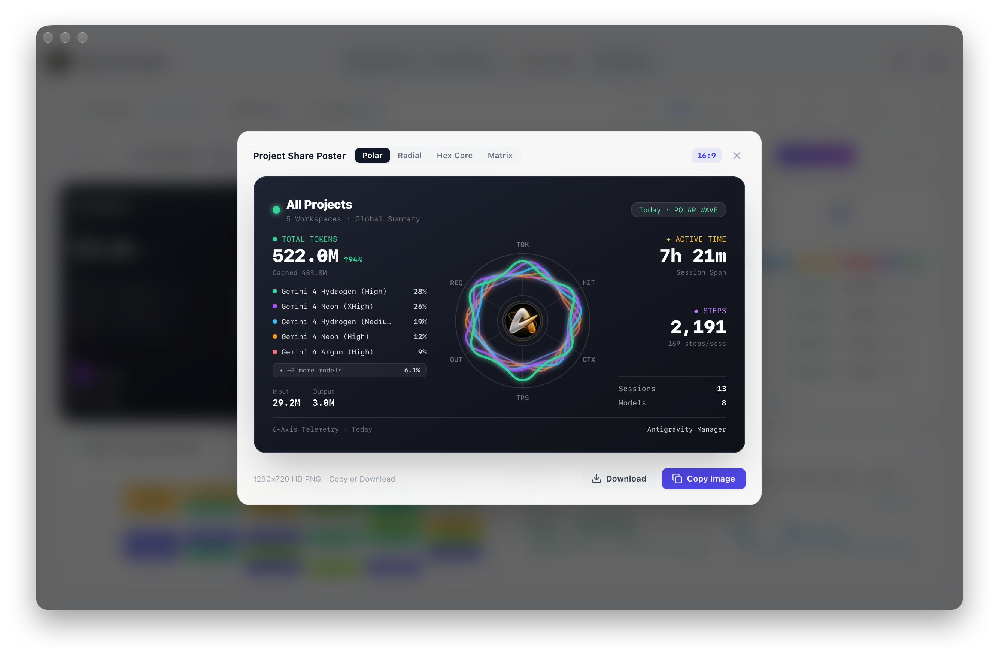<br />
      <sub><b>Polar Wave</b> — 六轴极坐标声波</sub>
    </td>
    <td width="50%" align="center">
      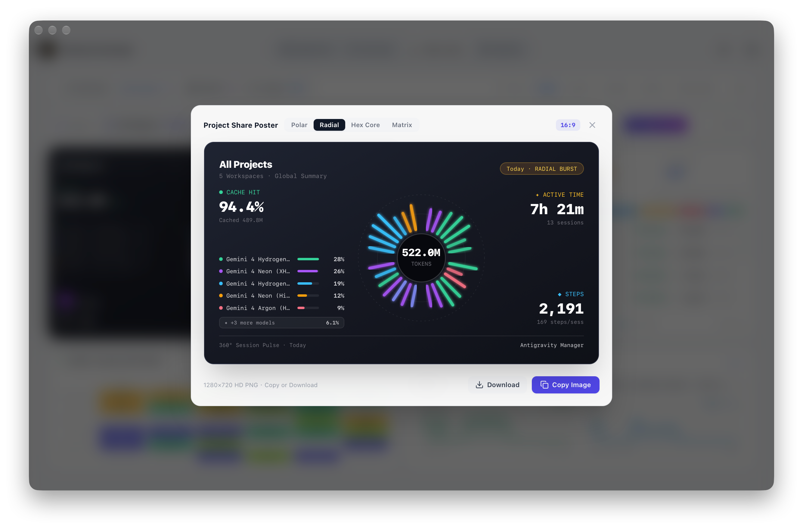<br />
      <sub><b>Radial Burst</b> — 360° 会话脉冲星芒</sub>
    </td>
  </tr>
  <tr>
    <td width="50%" align="center">
      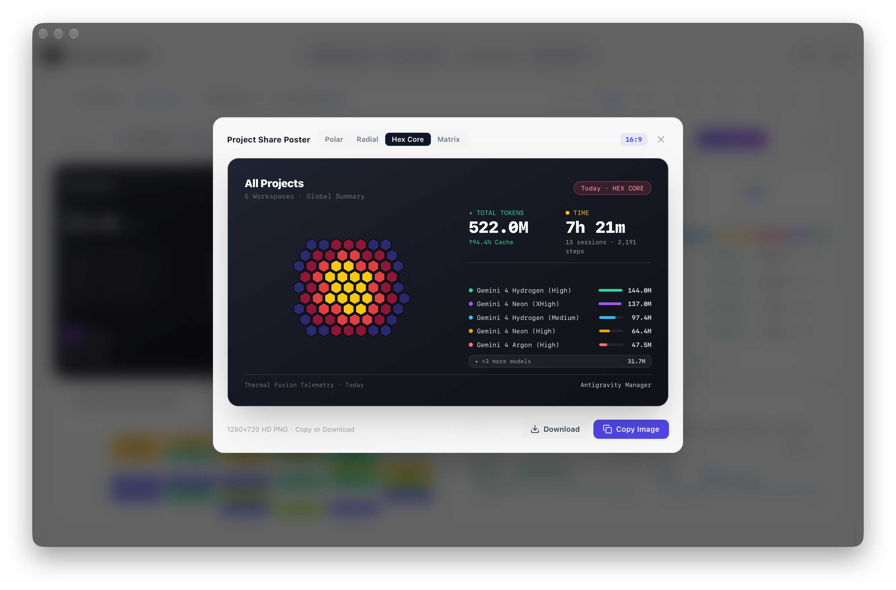<br />
      <sub><b>Hex Core</b> — 热核蜂窝矩阵</sub>
    </td>
    <td width="50%" align="center">
      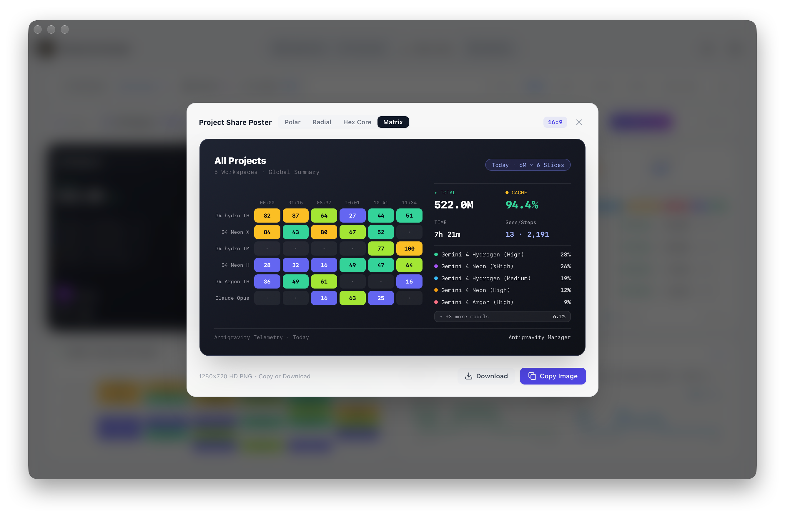<br />
      <sub><b>Slice Matrix</b> — 模型 × 会话时序热力图</sub>
    </td>
  </tr>
</table>

### 4. 守护进程策略、内置 CLI 速查与本地数据维护

<table>
  <tr>
    <td width="33.3%" align="center">
      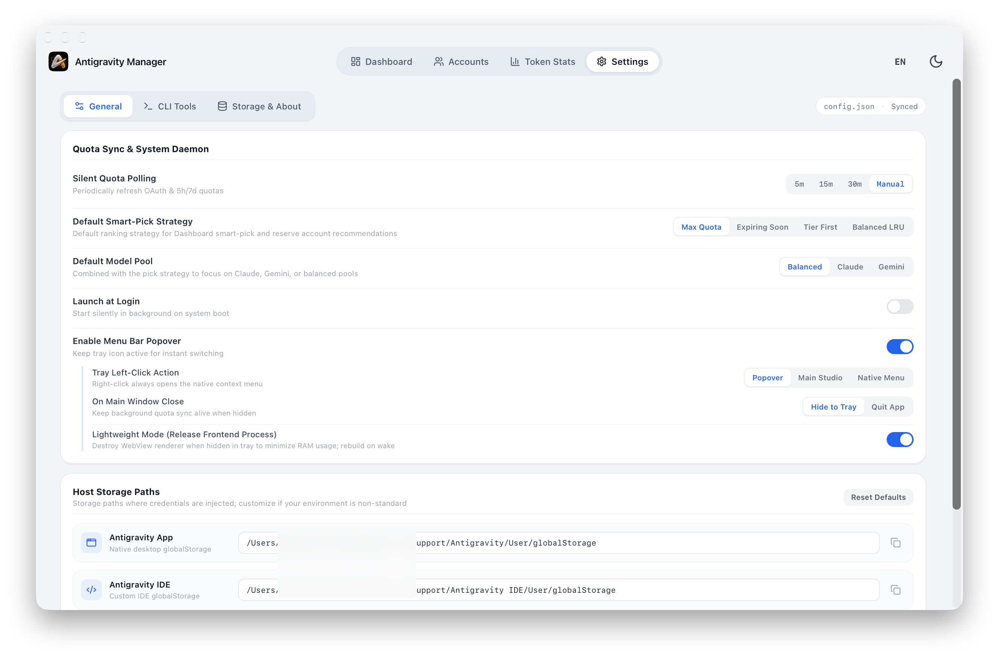<br />
      <sub><b>守护与宿主路径</b> — 静默轮询频率、默认选号策略、托盘交互、WebView 内存释放模式与自定义 <code>globalStorage</code> 路径。</sub>
    </td>
    <td width="33.3%" align="center">
      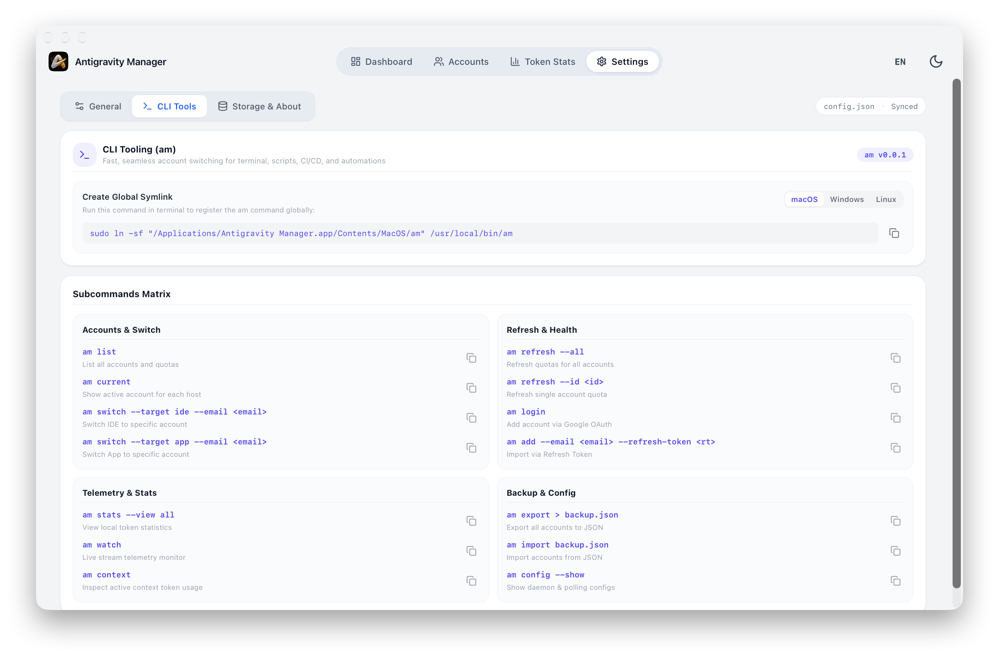<br />
      <sub><b>CLI 工具箱 (<code>am</code>)</b> — 一键复制全局软链注册命令，内置分类子命令速查矩阵。</sub>
    </td>
    <td width="33.3%" align="center">
      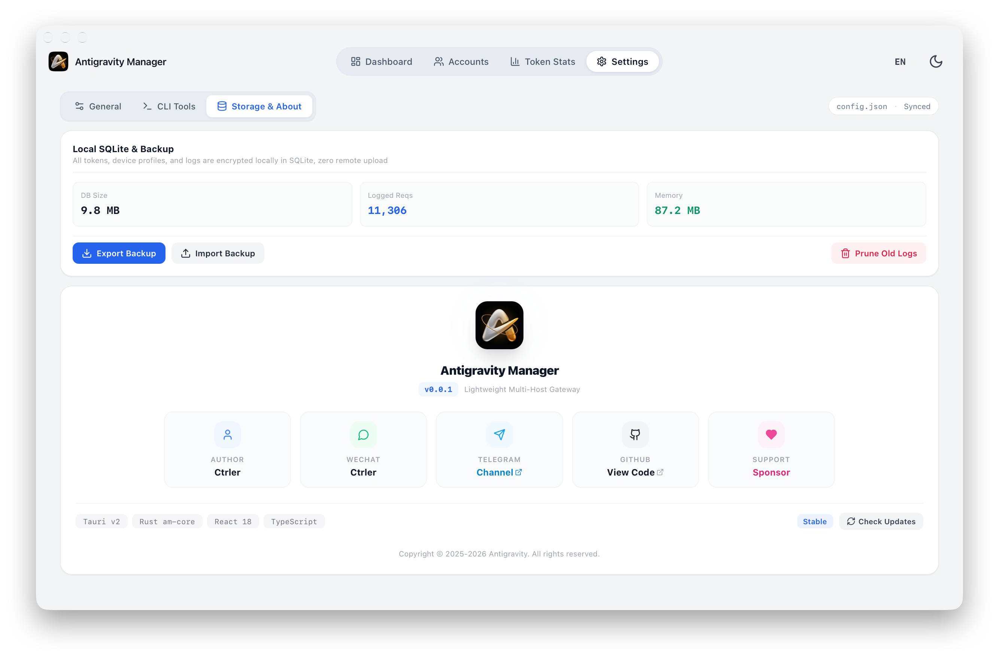<br />
      <sub><b>存储与版本更新</b> — 本地 SQLite 体积与内存监控、全量导入导出备份、旧日志清理与在线更新检查。</sub>
    </td>
  </tr>
</table>

---

## 📦 安装指南与 macOS 损坏修复

### 1. 下载预编译安装包或使用 Homebrew（推荐）

#### 方式一：直接下载安装包
请前往本分支专属的 **[`antigravity-manager` Release 发布页](https://github.com/lbjlaq/Antigravity-Manager/releases/tag/antigravity-manager)** 下载对应系统的安装包（注意区分仓库 `releases/latest` 主分支网关版）：

- **macOS**：Universal 通用版 / Apple Silicon (`aarch64`) / Intel (`x86_64`) `.dmg`
- **Windows**：`.msi` 或 NSIS `-setup.exe` (`x64`)
- **Linux**：`.deb` / `.rpm` / `.AppImage` (`x86_64` &amp; `arm64`)

#### 方式二：通过 Homebrew 一键安装（macOS &amp; Linuxbrew，自动清除 macOS 损坏提示并软链 `am` 命令）

```bash
brew tap lbjlaq/antigravity-manager https://github.com/lbjlaq/Antigravity-Manager
brew install --cask antigravity-manager
```

> 后续升级可执行 `brew upgrade --cask --greedy antigravity-manager`，或直接在客户端 **设置 → 存储与关于** 点击应用内一键在线更新。

### 2. 🛠️ macOS 提示「应用已损坏，无法打开」或「无法验证开发者」？

由于 macOS Gatekeeper 安全机制会对浏览器直接下载的非 App Store 应用附加 `com.apple.quarantine` 隔离属性，首次双击可能会误报 **“Antigravity Manager 已损坏，无法打开。你应该将它移到废纸篓”**。

将应用拖入「应用程序 (`/Applications`)」文件夹后，打开终端执行以下一条命令即可彻底修复：

```bash
sudo xattr -rd com.apple.quarantine "/Applications/Antigravity Manager.app"
```

> **图形界面备选方案**：若提示「无法验证开发者」，也可前往 **系统设置 → 隐私与安全性**，滑到底部找到拦截提示，点击 **「仍要打开」**。

<details>
<summary><b>🔧 更多常见平台问题排查（Linux Wayland 黑屏 / OAuth 授权回调失败）— 点击展开</b></summary>

#### Linux (Hyprland / Sway / niri 等合成器) 启动后窗口全黑或空白？
部分 Wayland 合成器下 WebKitGTK 的 DMA-BUF 渲染器可能出现黑屏，可通过环境变量临时禁用 DMA-BUF 启动：

```bash
env WEBKIT_DISABLE_DMABUF_RENDERER=1 am-gui
```

#### OAuth 添加账号时浏览器提示 `localhost refused connection`？
每次发起 OAuth 登录都会动态绑定一次性本地随机回调端口。请确保在应用弹窗（或终端 `am login` 命令）处于等待状态时打开**最新生成**的授权链接；若在远程无头服务器 / SSH 环境登录，请使用手动授权模式 `am login --manual` 粘贴回调 Code 完成绑定。

</details>

### 3. 从源码编译构建（指定 `antigravity-manager` 分支）

**环境要求**：Rust (`stable`)、Node.js (`>= 20`) 以及对应平台的 Tauri v2 系统依赖。

```bash
# 直接克隆 antigravity-manager 分支源码
git clone -b antigravity-manager --single-branch https://github.com/lbjlaq/Antigravity-Manager.git
cd Antigravity-Manager

# 方式一：仅编译独立 CLI 命令行工具 (`am`)
cargo build --release -p am-cli
./target/release/am --help

# 方式二：构建完整桌面客户端（含内嵌 `am` CLI Sidecar）
node scripts/prepare-sidecar.mjs
cd crates/am-gui/ui
npm install
npm run build

cd ../src-tauri
cargo tauri build
```

---

## 🛠 命令行工具全集 (`am`)

Antigravity Manager 内置原生跨平台 Rust 命令行程序 `am`（Windows 下为 `am.exe`），与桌面 GUI 共享同一套 `am-core` 数据库、设备指纹与零反代切号引擎。

### 注册全局 `am` 命令（`macOS` · `Windows` · `Linux` 全平台支持）

```bash
# macOS（.dmg 安装后创建全局软链）
sudo ln -sf "/Applications/Antigravity Manager.app/Contents/MacOS/am" /usr/local/bin/am

# Linux（将独立二进制安装至系统 PATH）
sudo install -Dm755 ./am /usr/local/bin/am

# 全平台源码直装（自动安装至 ~/.cargo/bin/am 或 %USERPROFILE%\.cargo\bin\am.exe）
cargo install --path crates/am-cli
```

```powershell
# Windows（PowerShell — 将安装目录加入当前用户 PATH 环境变量）
$d = "$env:LOCALAPPDATA\Antigravity Manager"
$p = [Environment]::GetEnvironmentVariable("Path", "User")
if ($p -notlike "*$d*") { [Environment]::SetEnvironmentVariable("Path", $(if ($p) { "$p;$d" } else { $d }), "User") }
```

### 高频实战命令示例

```bash
# 1. 账号检索、健康过滤与当前宿主状态
am list                                           # 列出所有账号及 Gemini/Claude 5h/7d 双池配额 (别名: am ls)
am list --healthy --tag work --sort quota         # 筛选带 work 标签的健康账号，并按剩余配额降序排列
am current                                        # 查看 App、IDE、ACP 插件、CLI 四端当前生效的账号 (别名: am whoami)

# 2. 四宿主精准热切与智能选号路由
am switch user@gmail.com --target ide             # 按完整邮箱、前缀或 ID 无感热切 IDE 账号 (别名: am use)
am switch user@gmail.com --target app --restart   # 切换原生桌面端账号并强制重启宿主进程
am switch --auto --target all --prefer claude     # 智能挑选 Claude 池最优账号并一次性同步至全部四大宿主
am switch --auto --target cli --strategy least-used --tag pro

# 3. OAuth 授权（桌面 & SSH 无头模式）、Refresh Token 录入与标签管理
am login                                          # 本地浏览器自动回调完成官方 Google OAuth 登录
am login --manual                                 # 无头服务器 / SSH 模式：终端打印授权链接，手动粘贴授权码
am add --token "<refresh_token>" --tags pro,team  # 直接通过 Refresh Token 导入账号并批量打标签
am refresh                                        # 立即刷新全部账号最新配额 (别名: am sync；也可传参刷新单号)
am tag user@gmail.com add vip,claude              # 账号标签管理 (支持 add | remove | set | ls)

# 4. 零反代本地遥测分析与实时流式监控
am stats --view all --range today                 # 终端查看今日 Token 统计 (--view all|account|model|app|timeline)
am stats --view model --range 7d --json           # 导出近 7 天模型维度统计 JSON（便于接入自定义脚本）
am watch --interval 2                             # 2 秒级实时流式监控当前宿主的 TPS 生成速率与 Token 脉搏
am context                                        # 诊断当前活跃会话的上下文窗口占用与缓存命中健康度

# 5. 设备指纹隔离、异常解锁、后台守护配置与环境自检
am fingerprint                                    # 检查当前活跃宿主客户端指纹与本地账号配置是否对齐
am device-reset user@gmail.com                    # 为指定账号重新生成并绑定全新独立硬件指纹
am unblock user@gmail.com                         # 一键清除账号的 403 / 验证锁定标记
am config --show                                  # 查看后台轮询、自动切号、托盘交互与轻量模式配置
am config --auto-switch on --quota-polling on --interval-minutes 15 --lightweight on
am export -o backup.json                          # 导出全量账号便携备份 JSON
am import backup.json --overwrite                 # 从备份 JSON 批量恢复账号（同名 ID 覆盖更新）
am doctor                                         # 一键诊断本地 SQLite 健康度与四大宿主安装/存储路径
am update                                         # 检查 antigravity-manager 独立发布通道是否有新版本
```

<details>
<summary><b>📖 展开查看完整 22 个 <code>am</code> 子命令参数速查表</b></summary>

| 子命令 | 别名 | 核心参数 / 选项 | 功能说明 |
| :--- | :---: | :--- | :--- |
| `am list` | `ls` | `--tag`, `--healthy`, `--sort`, `--json` | 列出所有账号及 `5h/7d` 双池配额（支持按 `quota\|priority\|last-used\|recent\|created\|email` 排序）。 |
| `am current` | `whoami` | — | 查看 `App`、`IDE`、`ACP 插件`、`CLI` 四大宿主当前激活的账号。 |
| `am switch [acc]` | `use` | `-t/--target`, `--auto`, `--strategy`, `--prefer`, `--tag`, `--restart` | 针对 `ide`、`app`、`plugin`、`cli` 或 `all` 执行热切或智能选号（策略支持 `max-quota\|least-used\|priority\|random`）。 |
| `am login` | — | `-m/--manual` | 通过 Google OAuth 授权新增账号（`--manual` 适配无浏览器 SSH 环境）。 |
| `am add` | — | `-t/--token <rt>`, `--tags a,b` | 直接使用 Google OAuth Refresh Token 录入账号并绑定初始标签。 |
| `am refresh [acc]` | `sync` | `[account]` | 刷新单个指定账号配额；省略参数则并发同步全量账号配额。 |
| `am tag <acc>` | — | `add` \| `remove` (`rm`) \| `set` \| `list` (`ls`) | 对指定账号增删、覆盖或查看标签列表。 |
| `am disable <acc>` | — | `-r/--reason <text>` | 手动禁用指定账号（移出自动智能选号候选池）。 |
| `am enable <acc>` | — | — | 重新启用已被手动禁用的账号。 |
| `am unblock <acc>` | — | — | 清除指定账号上的 `403` 或风控验证锁标记。 |
| `am delete <acc...>` | `rm` | `<id_or_email...>` | 支持一次删除单个或多个账号。 |
| `am reorder <ids...>` | — | `<id1> <id2> ...` | 按传入 ID 顺序持久化调整账号排列优先级。 |
| `am fingerprint` | — | — | 检测当前活跃宿主的设备指纹及本地/远端一致性状态。 |
| `am device-reset <acc>` | — | — | 为指定账号重新生成一套全新的隔离设备特征档案。 |
| `am stats` | — | `-v/--view`, `-r/--range`, `--date`, `--json` | 查看本地零反代 Token 统计（视角：`all\|account\|model\|app\|timeline`，范围：`today\|7d\|30d\|all`）。 |
| `am context` | — | — | 检查当前活跃对话上下文窗口的 Token 构成与缓存健康状况。 |
| `am watch` | — | `-i/--interval <secs>` | 实时滚动监控当前活跃宿主的生成速率（TPS）与请求动态。 |
| `am config` | — | `--show`, `--auto-switch`, `--quota-polling`, `--interval-minutes`, `--tray`, `--tray-click`, `--close-to-tray`, `--quiet-autostart`, `--lightweight` | 在终端读取或修改后台自动切号、静默轮询、托盘行为与轻量模式开关。 |
| `am export` | — | `-o/--output <path>` | 将全量账号导出为便携式 JSON 备份文件。 |
| `am import <file>` | — | `-o/--overwrite` | 从 JSON 备份文件批量导入账号。 |
| `am update` | — | — | 检查 `antigravity-manager` 专属 Release 通道更新。 |
| `am doctor` | — | — | 检查系统运行环境、SQLite 数据库及四大宿主路径状态。 |

</details>

---

## 🏗 系统架构

项目采用模块化 Rust Workspace 架构，将核心领域能力沉淀于无 UI 依赖的 `am-core`，同时驱动桌面端 `am-gui` 与命令行 `am-cli`：

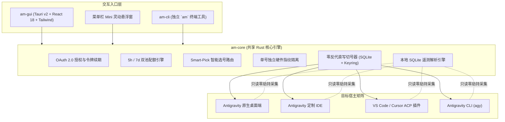

```text
Antigravity-Manager/           # (所在分支: antigravity-manager)
├── crates/
│   ├── am-core/               # 核心 Rust 库：OAuth、5h/7d 双池配额、智能策略、
│   │                          # SQLite/Keyring 零反代切号、设备指纹隔离与本地遥测统计
│   ├── am-cli/                # 独立无头命令行程序 (`am`)，提供完整 22 子命令能力
│   └── am-gui/
│       ├── src-tauri/         # Tauri v2 原生宿主、系统托盘弹窗、自动更新与 IPC 桥接
│       └── ui/                # React 18 + TypeScript + Tailwind CSS 界面与 12 语言国际化
└── docs/
    ├── GUI_DESIGN.md          # 界面视觉规范与组件设计文档
    └── assets/                # 品牌图标、赞助商标识与产品实机截图资源
```

---

## 🚀 关联生态项目 (Ecosystem)

- **[Antigravity Tools（本仓库 `main` 主分支）](https://github.com/lbjlaq/Antigravity-Manager/tree/main)**：全功能 AI 账号调度与多协议转换网关系统（支持 OpenAI / Claude / Gemini 本地 API 反代、模型路由及 Docker 无头部署）。

---

## 📝 更新日志

首页仅保留最新版本摘要，完整中英双语变更记录请查阅 **[CHANGELOG.md](CHANGELOG.md)**，安装包下载请前往 **[`antigravity-manager` 专属 Release 页面](https://github.com/lbjlaq/Antigravity-Manager/releases/tag/antigravity-manager)**。

- **v0.0.1 (`am-core` 模块化架构版)**：重构为 `am-core` + `am-cli` + `am-gui` Rust 工作空间；支持 `App` / `IDE` / `ACP` / `CLI` 四宿主零反代直写热切、`5h`/`7d` Gemini &amp; Claude 双池配额监控、本地 SQLite 全链路 Token 遥测分析、`16:9` 高清战报海报导出、菜单栏双模 Mini 灵动悬浮窗以及三端内嵌 `am` CLI Sidecar。

---

## 🤝 社区与许可声明

- **作者**：**Ctrler** ([@lbjlaq](https://github.com/lbjlaq))
- **Telegram 频道**：[@AntigravityManager](https://t.me/AntigravityManager)
- **微信公众号**：`Ctrler`
- **开源赞助**：[GitHub Sponsors ❤️](https://github.com/sponsors/lbjlaq)
- **隐私与安全声明**：本应用所有账号凭证、硬件指纹与遥测统计均存储于您的设备本地 SQLite 数据库中，绝不上传任何远端服务器。
- **版权许可**：基于 **[CC BY-NC-SA 4.0](LICENSE)** 许可协议开源，**严禁任何形式的商业售卖或商业化行为**。

<div align="center">
  <p>如果您觉得这个工具有所帮助，欢迎在 GitHub 上点一个 ⭐️</p>
  <p>Copyright © 2024–2026 Antigravity Team. All rights reserved.</p>
</div>
