# Antigravity Manager GUI 设计与产品架构规范 (Apple HIG 级)

## 1. 产品定位与整体架构

Antigravity Manager 桌面客户端 (`am-gui`) 是专为专业开发者打造的轻量化 Google AI 账号多端管理器与本地推理用量监控中心。

### 1.1 设计哲学
- **克制与原生感 (Apple HIG)**：遵循 macOS Sonoma / Sequoia 原生人机交互规范，采用微磨砂毛玻璃 (`backdrop-blur-2xl`)、拟物圆角 Squircle、自然弹性动效与精致边框，拒绝粗糙的网页感与笨重的后台管理模板。
- **纯粹 SDK 解耦**：GUI 完全作为轻量展示层与控制层，所有数据、热切换、指纹隔离与统计计算 100% 由 `crates/am-core` 驱动，零多余网络代理中间人，极低系统开销（常驻内存目标 `< 35MB`）。
- **双模态无感交互**：
  1. **状态栏常驻模式 (Menu Bar / Tray Popover)**：360px 宽度悬浮小卡，高频看一眼额度、一秒快捷切号，点开即用，移开即隐。
  2. **主程序大窗模式 (Main Studio)**：1020px × 680px 专业全景工作台，支持窗口缩放与沉浸式数据分析。

---

## 2. 全局导航结构

主程序大窗采用经典的三段式布局：**左侧导航栏 (Sidebar, 220px) + 右上全局工具栏 (Toolbar) + 主画布区 (Main Canvas)**。

四大核心一级菜单：
1. **🏠 首页 (仪表盘 / Dashboard)**：全局状态中枢、快捷切号中心、全局 Token 成本大盘、实时流速与会话水位。
2. **👥 账号管理 (Accounts)**：账号资产池、双环配额雷达、标签管理、批量导入导出。
3. **📊 统计分析 (Stats & Insights)**：真实物理模型保真度排行榜、24h 心跳分布、账号用量归因。
4. **⚙️ 系统设置 (Settings & Automation)**：智能故障自动切换、静默配额轮询、设备指纹隔离。

---

## 3. 首页（仪表盘 / Dashboard）详细设计

仪表盘采用现代企业级与 Apple 工业设计的 **“2 × 2 黄金网格便当盒 (Golden Grid Bento Layout)”**，聚焦四大核心商业诉求，权责极其清晰。

```
┌──────────────────────────────────────────────────────────────────────────────────┐
│ 🔴 🟡 🟢  Antigravity Manager                                   [ 2026-11-22 ▾ ] │
├────────────────────────────────────────┬─────────────────────────────────────────┤
│                                        │                                         │
│ 【子模块 1：快捷多端切号中心】           │ 【子模块 2：全局配额池健康度】            │
│  (Quick Switch & Host Matrix)          │  (Global Quota Pools & Reserve)         │
│  · 4 宿主状态胶囊 (App/IDE/Plugin/CLI) │  · Claude 3.7/3.5 总体可用配额环形图    │
│  · 当前选中宿主的账号卡片与一键切换下拉 │  · Gemini 2.5/Pro 总体可用配额环形图    │
│  · 智能一键选号按钮 (Max-Quota/Claude) │  · 额度即将重置倒计时雷达               │
│                                        │                                         │
├────────────────────────────────────────┼─────────────────────────────────────────┤
│                                        │                                         │
│ 【子模块 3：全局 Token 用量与成本看板】 │ 【子模块 4：当前活跃会话深度与流速】     │
│  (Global Token & Cost Metrics)         │  (Active Session Depth & Live Stream)   │
│  · 今日 Token 总量 (2.7M) / 净消耗 (390K)│  · 活跃会话水位条 (92.5K / 256K - 36%) │
│  · 缓存命中率 (85.7% / 97.9%)          │  · 实时流速 TPS 动态胶囊 (163 tok/s)    │
│  · 估算节省费用 ($38.51 USD)           │  · 真实物理模型 (gemini-4-hydrogen)     │
│  · 今日请求频次 (79 次 / 平均首字 2.8s) │  · 上下文分层水库折叠抽屉               │
│                                        │                                         │
└────────────────────────────────────────┴─────────────────────────────────────────┘
```

---

### 子模块 1：快捷多端切号中心 (Quick Switch & Host Matrix)
> **设计目标**：继承并超越主分支的核心优点，让开发者在首页无需跳转页面即可完成 4 大宿主靶标的秒级账号切换。

#### 页面结构与交互
1. **宿主分段选择器 (Host Segmented Control)**：
   - 顶部提供 4 档分段器：`[ 🟢 原生 App ]` `[ 🟢 IDE 定制版 ]` `[ ⚪ ACP 插件 ]` `[ ⚪ agy CLI ]`。
   - 呼吸绿点代表宿主进程正在系统中运行；灰点代表未启动。
   - 单击切换当前查看/操作的目标宿主。
2. **当前宿主绑定账号展示卡片**：
   - 居中展示当前绑定的账号（如 `user1@gmail.com`），附带用户昵称与专属标签（如 `[🌟 主力]` `[VIP]`）。
   - 双进度徽章：直观标明该账号在当前宿主中的 Claude (`85%`) 与 Gemini (`100%`) 实时额度。
3. **一键快捷换号下拉框 (Quick Switch Dropdown)**：
   - 点击展开当前所有有效账号的候选下拉菜单，按可用配额自动降序排列。
   - 每个下拉项显示：邮箱、Claude/Gemini 额度条、重置时间。
   - 单击账号项，`am-core` 在后台以毫秒级将 Token 注入目标宿主配置文件，提供自然温润的“已切换”触觉动效。
4. **敏捷动作按钮**：
   - `[ ⚡ 智能选号 ]`：根据预设策略（如剩余配额最高、或最久未用），一键将最适合该宿主的账号切过去。
   - `[ 🔄 刷新当前 ]`：静默调用 Google OAuth 与配额 API，对当前宿主绑定的单账号进行保鲜校验。

---

### 子模块 2：全局配额池健康度 (Global Quota Pools & Reserve)
> **设计目标**：以宏观资产视角，向开发者直观呈现名下“账号军团”的总弹药存量，消除额度焦虑。

#### 页面结构与交互
1. **双同心环全景配额仪表 (Dual Concentric Pool Gauges)**：
   - **外环 (Claude 核心池，紫色渐变光晕)**：汇总全量有效账号中 Claude 模型的加权平均可用率（如 `78.4% 可用`）。
   - **内环 (Gemini 核心池，蔚蓝渐变光晕)**：汇总全量有效账号中 Gemini 模型的加权平均可用率（如 `92.1% 可用`）。
   - 环中央数字：当前可用总容量评分或可用主力账号数（如 `39 / 41 正常`）。
2. **账号阵列健康状态一览**：
   - 四色小胶囊：`正常可用: 39`（绿）、`额度归零: 2`（黄）、`失效/封禁: 0`（红）、`已禁用: 0`（灰）。
3. **最早额度恢复雷达 (Next Quota Reset Radar)**：
   - 精确计算所有账号中，距离当前最近的配额重置时间。
   - 示例展示：`⏱ 最近额度恢复: 1小时 15分后 (user3@gmail.com · Claude 恢复至 100%)`。

---

### 子模块 3：全局 Token 用量与成本看板 (Global Token & Cost Metrics)
> **设计目标**：从本地 SQLite 数据库中提炼高价值的商业与技术指标，给开发者带来极高的掌控感与成就感。

#### 页面结构与交互
1. **时间范围过滤器 (Time Range Pills)**：
   - 右上角轻量分段药丸：`[ 今天 ]` `[ 昨天 ]` `[ 近3天 ]` `[ 近7天 ]` `[ 近30天 ]`。
2. **核心 4 大指标数据方块**：
   - **方块 A：总 Token 吞吐**
     - 大字号排版：`2.75M Tokens`。
     - 辅助信息：直接输入 `390.0K` · 模型输出 `17.3K`。
   - **方块 B：缓存命中率 (Cache Hit Rate)**
     - 大字号排版：`85.7%`（以苹果高亮翡翠绿显示）。
     - 辅助信息：输入缓存占比极大，减少了上游响应延迟并提升吞吐。
   - **方块 C：估算节省费用 (API Cost Saved)**
     - 大字号排版：`$38.51 USD`（绿色高亮）。
     - 辅助信息：对比公有云无缓存的 Token 标价，本地缓存累计节省金额。
   - **方块 D：请求响应性能 (Performance Benchmarks)**
     - 大字号排版：`118.6 tok/s` 平均生成流速。
     - 辅助信息：首字延迟中位数 `2.8s` · 累计 `79 次请求`。

---

### 子模块 4：当前活跃会话深度与流速 (Active Session Depth & Live Stream)
> **设计目标**：零代理实时监控开发者当前正在进行的编码会话，杜绝上下文溢出，识别模型是否被暗降。

#### 页面结构与交互
1. **会话深度水位进度条 (Context Window Watermark)**：
   - 核心数字：`当前已用 92.5K (36.1%)` / `预算上限 256K` / `剩余可用 163.5K`。
   - **分层水库色彩条 (Reservoir Breakdown)**：
     - 翠绿：缓存读取输入（`Cache Read: 35.6K`）
     - 蔚蓝：直接用户提示（`Direct Prompt: 2.5K`）
     - 紫色：深度思考/推理 Token（`Thinking: 18.7K`）
     - 琥珀黄：工具调用与执行日志（`Tool Stream: 33.7K`）
     - 玫瑰红：模型最终生成文本（`Model Output: 5.7K`）
   - 水位健康诊断：`✓ 当前用量健康，剩余可用空间充足，可正常继续对话`。
2. **实时流速动态心跳药丸 (Live Throughput Pill)**：
   - 当检测到后台语言模型正在打字输出时，胶囊动态呼吸：
     `⚡ 163 tok/s · 首字 2.8s · 状态: 输出中...`
   - 空闲时显示：`⚡ 上次生成: 151 tok/s · 3分钟前`。
3. **真实物理模型保真度提示 (Model Fidelity Badge)**：
   - 标注：`客户端请求: gemini-pro ➔ 物理执行: gemini-4-hydrogen-high`。
   - 若检测到被云端暗降（如降至低级保守模型），立即以琥珀色高亮提示。

---

## 4. 账号管理（Accounts）详细设计

账号管理模块致力于在**完全摒弃多余占位头像**的前提下，提供**极高信息密度、极低操作摩擦力**的专业级 Google AI 账号资产库。支持真实生态中动态的多组模型限额（如 Gemini Models、Claude and GPT、Gemini 4 Argon）以及 **5 小时 / 7 天双时间周期**的精准呈现。

```
┌────────────────────────────────────────────────────────────────────────────────────────────────────────┐
│ 【子模块 2.1：资产检索、标签过滤与多维透视栏 (Filter & View Toolbar)】                                      │
│  🔍 搜索邮箱/备注...  [全部 (41)] [PRO (12)] [🌟主力 (5)] [Claude池 (18)] [⚠️异常/耗尽 (2)]  [条状卡片 | 密集表格] │
├────────────────────────────────────────────────────────────────────────────────────────────────────────┤
│ 【子模块 2.2：高密度账号资产卡片流 (Bento Row Grid) / 全景表格 (Data Table)】                              │
│  ┌──────────────────────────────────────────────────────────────────────────────────────────────────┐  │
│  │ 【列 1：账号身份、宿主与标签】    【列 2：多组配额矩阵 (5h / 7d 双周期)】     【列 3：专属切换部件与动作】│  │
│  │                                                                                                  │  │
│  │  ctrler@868666.best [PRO]       🔹 Gemini Models                            [ 🚀 快速推至... ▾ ] │  │
│  │  (开发主力机)                    5h: 100% (4h54m) │ 7d: 100% (6d23h)          ├─ 🚀 原生 App (当前)│  │
│  │                                                                               ├─ 🚀 IDE 定制版     │  │
│  │  [🌟 主力] [VIP] [Claude池]     🟣 Claude and GPT models                    ├─ 🚀 ACP 插件       │  │
│  │  [+ 标签]                        5h: 100% (4h50m) │ 7d:  50% ⚠️ (5d13h)       └─ 🚀 agy CLI        │  │
│  │                                                                                                  │  │
│  │  🟢 正在【原生 App】中运行       🔸 Gemini 4 Argon                            [ 🔄 刷新 ]          │  │
│  │                                  7d: 100% (6d18h)                            [ ••• 菜单 ]         │  │
│  └──────────────────────────────────────────────────────────────────────────────────────────────────┘  │
│  (支持 40+ 账号丝滑滚动瀑布流，单屏可呈现 6~8 个完整账号，信息密度比旧版翻倍)                           │
├────────────────────────────────────────────────────────────────────────────────────────────────────────┤
│ 【子模块 2.3：批量运维与多端分发控制岛 (Batch Ops & Ingestion Dock)】                                       │
│  已选中 3 个账号 ── [ 🔄 批量刷新配额 ] [ 🏷️ 批量打标签 ] [ 🚀 均衡轮转分发 ] [ 🗑️ 批量删除 ]             │
│  右侧常驻操作：                                                       [ 📥 导入备份 ] [ ➕ 官方授权登录 ] │
└────────────────────────────────────────────────────────────────────────────────────────────────────────┘
```

### 4.1 子模块划分与交互细节

#### 子模块 2.1：资产检索、标签过滤与多维透视栏
1. **即时模糊检索**：输入邮箱前缀、自定义备注名或标签名称，前端 `< 5ms` 无感实时过滤。
2. **多维分类 Pills**：
   - `全部 (41)`
   - `PRO 订阅 (12)`：快速过滤付费订阅高配额账号。
   - `🌟 主力号 (5)`
   - `Claude 池 (18)` / `Argon 池 (6)`
   - `⚠️ 异常/耗尽 (2)`：快速定位 `is_forbidden: True` 或 7d/5h 额度归零的账号。
3. **视图切换控制器 (View Switcher)**：
   - **条状卡片视图 (Bento Row)**：默认推荐，清晰展示多组进度条与状态。
   - **全景密集表格 (Data Table)**：将 5h/7d 压缩为紧凑百分比数字列，适合超大规模账号集中对账。

#### 子模块 2.2：高密度账号卡片（核心部件三列流线布局）
1. **列 1：身份、多端归属与标签系统**：
   - 邮箱粗体排版，右侧附带订阅级别徽章 `[ PRO ]`（紫金微光）或 `[ FREE ]`。
   - **多端宿主运行指示器 (Host Living Pill)**：
     - 若当前账号在原生 App、IDE、ACP 插件中正在运行，左侧亮起翠绿呼吸灯并标明 `🟢 正在【原生 App】中运行`。
     - 若未分配，显示淡灰色 `⚪ 空闲备用`。
   - **内联标签胶囊与即时编辑**：
     - 账号绑定的标签（如 `[ 主力 ]` `[ VIP ]`）作为半透明圆角药丸展示。
     - 点击卡片上的 `[ + 标签 ]` 按钮，弹出迷你浮层，点击已有标签即可打上或取消，**0 弹窗打断，即时生效**。
2. **列 2：多组配额矩阵与 5h / 7d 双周期仪表**：
   - 动态支持官方返回的 1~3 组（乃至更多）模型池（`Gemini Models`、`Claude and GPT models`、`Gemini 4 Argon`）。
   - 每组包含双时间窗口指示：
     - **5 小时限流 (Five Hour Limit)**：短周期生成额度，显示百分比与距离重置时间（如 `5h: 100% · 4h54m 后全满`）。
     - **周级限流 (Weekly Limit)**：长周期总配额，当低于 30% 时进度条显示琥珀警示色（如 `7d: 50% · 5d13h 后全满`）。
   - **风控与 403 诊断徽章**：若检测到 `is_forbidden: True`，整行以警示色高亮，并提示“地区不支持或订阅失效”，提供一键禁用按钮。
3. **列 3：专属切换部件与敏捷操作岛**：
   - **多端切换触发器 (Multi-Target Switch Button)**：
     - 主按钮：`[ 🚀 切给当前宿主 ]`（一键推送至当前活跃应用）。
     - 下拉分支：展开 4 大宿主靶标（`切给 原生 App`、`切给 IDE 定制版`、`切给 ACP 插件`、`切给 agy CLI`）。点击后秒级更新系统配置，左侧状态灯瞬间联动点亮。
   - **次要操作菜单**：`[ 🔄 单账号刷新 ]`、`[ 复制 Refresh Token ]`、`[ 修改备注 ]`、`[ 🚫 临时禁用 ]`、`[ 🗑️ 删除账号 ]`。

#### 子模块 2.3：批量运维与底部控制岛
1. **批量选中操作 (Batch Operations)**：支持多选账号进行批量配额刷新、批量打标签或批量安全删除。
2. **无感接入流程 (Zero-friction Onboarding)**：
   - `[ ➕ 官方授权登录 ]`：绑定本地随机 `:0` 端口，自动呼起默认浏览器完成官方 OAuth，回调秒级入库，无需手工粘贴 code。
   - `[ ➕ 粘贴 Refresh Token ]`：极客模式，适合服务器环境快速导入。
   - `[ 📥 导入备份 / 📦 导出备份 ]`：支持便携 JSON 格式的全量账号安全迁移。

---

## 5. 统计与分析（Stats & Insights）详细设计

本模块完全基于我们在 `am-core` 中硬核构建的**零代理纯本地数据分析引擎 (Zero-Proxy Analytics Engine)**。数据 100% 来源于本地 `conversation_summaries.db` 与 `transcript.jsonl`，实现无中间人拦截、无风控顾虑的极客级透视。

统计模块由顶部的二级分段控制器进行组织，划分为两个核心视图：
1. **【📈 宏观多维分析 (Aggregated Insights)】**：五大原生透视维度（账号分类、模型谱系、应用宿主、时间生物钟、上下文水库）。
2. **【🌊 流量与请求流水 (Traffic Ledger & Sessions)】**：每一条真实网络请求的原子账本、会话级深度透视与性能抽屉。

```
┌────────────────────────────────────────────────────────────────────────────────────────┐
│  📊 统计与洞察              [ 📈 宏观多维分析 ]   [ 🌊 流量与请求流水 ]                         │
└────────────────────────────────────────────────────────────────────────────────────────┘
```

---

### 5.1 视图 A：【📈 宏观多维分析】（五大多维切片体系）

面向技术决策与全局成本评估，直接映射 `MasterAnalyticsReport` 数据实体，自上而下呈现五大结构化卡片：

#### 维度 1：真实物理模型谱系与保真度排行 (Model Performance Matrix)
> 对应后端结构体：`ModelPerformanceGroup`

- **设计目标**：彻底解决开发者对“模型被云端降级”、“物理真实流速是多少”的知情权。
- **呈现结构 (Apple-grade Table)**：
  - **用户请求模型 (Requested Model)**：如 `claude-3-7-sonnet`、`gemini-pro`。
  - **物理真实上游 (Physical Upstream)**：还原为 Google 内部真实的 `gemini-4-hydrogen-high`、`gemini-4-neon` 等代号。
  - **流速与首字延迟**：
    - 平均吞吐速率：带横向进度微条（如 `225 tok/s` 翡翠绿高亮、`102 tok/s` 青色）。
    - 平均首字响应 (TTFT)：毫秒级统计（如 `4.8s`、`13.0s`）。
  - **暗降告警状态 (Downgrade Alert)**：
    - 若 `is_downgraded = true`（如物理执行退化为 `used_claude_conservative`），整行标记醒目的琥珀警示徽章，直观揭露云端路由偷换模型的行为。

#### 维度 2：账号归属与成本节约矩阵 (Account Attribution Matrix)
> 对应后端结构体：`AccountUsageGroup`

- **设计目标**：精确量化名下几十个账号分别消耗了多少 Token，谁是最高产账号，本地缓存为各个账号省下了多少美金。
- **呈现结构**：
  - **账号邮箱与业务标签**：如 `ctrler@868666.best`，附带 `[🌟 主力]` `[PRO]` 标签。
  - **Token 构成拆解**：直接输入 (New Input)、缓存读取 (Cached)、模型生成 (Output) 细项。
  - **缓存命中率 (Cache Hit Rate)**：以百分比高亮展示（如 `98.2%`）。
  - **累计已省成本 (Cost Saved)**：基于官方公有云未命中缓存的标价差额，以加粗绿色大字呈现（如 `已省 $24.10 USD`）。
  - **当前账号健康度与剩余配额**：附带该账号当前 Claude/Gemini 配额余量。

#### 维度 3：多端宿主与工作区分布 (Host & Workspace Distribution)
> 对应后端结构体：`HostWorkspaceGroup`

- **设计目标**：展示四个靶标应用与各个项目工程的使用占比。
- **呈现结构**：
  - **4 宿主用量环形图**：`Antigravity 原生桌面版` (58%)、`Antigravity IDE` (32%)、`ACP 插件` (8%)、`agy CLI` (2%)。
  - **高频活跃工程排行 (Top Workspaces)**：展示生成代码最多的工程目录（如 `my-web-app`、`core-backend`），帮助开发者了解不同项目的资源消耗。

#### 维度 4：24 小时生物钟热力分布 (Circadian Rhythm Heatmap)
> 对应后端结构体：`TemporalRhythmGroup`

- **设计目标**：可视化开发者从清晨到深夜的代码产出生物钟与系统负载峰值。
- **呈现结构**：
  - 四大时间区间聚合：
    - `清晨与上午 Morning (06:00 - 12:00)`
    - `午后黄金期 Afternoon (12:00 - 18:00)`
    - `深度思考夜 Evening (18:00 - 24:00)`
    - `深夜与极客时段 Night (00:00 - 06:00)`
  - 展示各区间的请求总量、吞吐 Token 数、峰值流速 (Peak TPS)。

#### 维度 5：会话深度与分层水库透视 (Active Context Window Reservoir)
> 对应后端结构体：`ContextWindowSnapshot`

- **设计目标**：深度解构当前会话的上下文深度，精确预警水位。
- **呈现结构**：
  - 类似 macOS 存储条的五色流线水库：
    - 翡翠绿：缓存读取输入（`Cached: 35.6K (Hit 97.9%)`）
    - 蔚蓝：直接用户提示（`Direct Prompt: 2.5K`）
    - 紫色：深度思考/推理 Token（`Thinking: 18.7K`）
    - 琥珀黄：工具调用与执行流（`Tool Stream: 33.7K`）
    - 玫瑰红：最终回答（`Completion: 5.7K`）
  - 核心水位比：`92.5K / 256K (健康度 36.1%)`，剩余 `163.5K`，告警阈值支持自适应变色。

---

### 5.2 视图 B：【🌊 流量与请求流水】（原子级账本与会话透视）
> 对应后端实体：`RequestLedgerEntry`

面向对每一笔请求都有极致掌控欲的极客与架构师，以亚秒级精度记录并还原每一次与 Google 大模型的真实交互。

```
┌────────────────────────────────────────────────────────────────────────────────────────────────────────┐
│ 【顶层过滤器】 时间: [今天 ▾]  宿主: [全部宿主 ▾]  模型: [全部模型 ▾]  账号: [全部账号 ▾]  🔍 搜索关键词... │
├────────────────────────────────────────────────────────────────────────────────────────────────────────┤
│ 时间   应用/宿主   请求模型 ➔ 真实物理模型    输入/缓存           输出(Tokens)  流速(TPS)    首字延迟  估算成本│
├────────────────────────────────────────────────────────────────────────────────────────────────────────┤
│ 03:27  🔺 App     gemini-pro ➔ Hydrogen   11.6K (154K Cache)  6,916        ⚡ 163 tok/s  ⏱ 3.7s   $0.0808 │
│ 02:35  🔺 App     gemini-pro ➔ Hydrogen    3.9K (150K Cache)  8,722        ⚡ 169 tok/s  ⏱ 3.5s   $0.0825 │
│ 02:31  📘 IDE     gemini-pro ➔ Hydrogen    2.8K (147K Cache)    335        ⚡  97 tok/s  ⏱ 2.9s   $0.0179 │
│ 02:27  🔺 App     gemini-pro ➔ Hydrogen    2.6K (145K Cache)    504        ⚡ 117 tok/s  ⏱ 3.1s   $0.0187 │
│ 02:06  🔺 App     gemini-flash ➔ Carbon   20.8K (109K Cache)    362        ⚡  48 tok/s  ⏱ 6.7s   $0.0421 │
└────────────────────────────────────────────────────────────────────────────────────────────────────────┘
```

#### 核心交互与透视抽屉 (Request Inspection Sheet)
1. **原子流水行设计**：
   - 每行清晰列出：请求时间、宿主图标（App/IDE/Plugin）、请求模型 vs 物理模型、新增输入与缓存命中数、输出 Token 数、实时流速与首字耗时。
2. **单行点击透视抽屉 (Slide-over Inspector)**：
   - 点击任意一条记录，右侧平滑滑出 Apple 风格的毛玻璃抽屉卡片：
     - **会话上下文元数据**：会话 ID、所属工作区工程路径、所属 Step 序号。
     - **账号精准归因**：指出这次请求对应生效的 Google 账号（Email 及配额状态）。
     - **水库细分指标**：直接输入、缓存复用、Thinking 推理 Token 数、工具调用 Token 数。
     - **耗时瀑布流**：连接握手耗时 ➔ 首字响应耗时 (TTFT) ➔ 流式生成总耗时。

---

### 5.3 账号详情统计与三维下钻设计规范 (Account Deep Dive & 3D Telemetry Specification)

为彻底解决同类工具与早期文档中“仅有初级剩余百分比、信息单薄、缺乏业务归因”的严重不足，我们将**账号详情统计**提升为专业级的**“算力资产与研发效能控制台”**。

在架构上，账号详情由顶部的**账号水平选择胶囊栏 (Account Switcher Bar)** 进行快速切片，每个选中的账号展示以下 **6 大高价值技术与资产模块**：

```
┌────────────────────────────────────────────────────────────────────────────────────────────────────────┐
│ 👤 ctrler@868666.best [PRO] [🌟主力]  🟢 挂载于 IDE  │  5h: 85% (45m满)  │  7d: 50% (3天重置)          │
├────────────────────────────────────────────────────────────────────────────────────────────────────────┤
│ 【模块 2：Token 实耗与 5h/7d 额度双向折算金库】                                                       │
│  • 累计总吞吐: 207.1M (命中率 91.2%)  │  等效实耗: $214.50 USD  │  缓存免计费已省: $188.00 USD        │
│  • 💎 5h 剩余换算: 约 38.2 万 Token (折合 $14.28 算力储备)                                            │
│  • 💎 7d 剩余换算: 约 225.0 万 Token (折合 $84.00 算力储备)                                           │
│  • 5 层 Token 构成: 🟢缓存 188M · 🔵输入 18.4M · 🟣思考 8.5M · 🟡工具 6.2M · 🔷输出 710K              │
├────────────────────────────────────────────┬───────────────────────────────────────────────────────────┤
│ 【模块 4：项目消耗流向矩阵】               │ 【模块 3：模型消耗与真实物理调度】                        │
│  (细分 Gemini vs Claude / 缓存率 / 流速)   │  (物理上游 / TPS / TTFT / 真实保真度)                     │
│  • 📂 at (68%)                             │  • claude-3-7 ➔ gemini-4-hydrogen-high                   │
│    Claude: 95M │ Gemini: 45M               │    120M (58%) │ ⚡ 184 tok/s │ ⏱ 1.42s                  │
│    缓存: 92.4% │ ⚡ 178 tok/s               │  • gemini-pro ➔ gemini-4-hydrogen-high                   │
│  • 📂 omin (22%)                           │    66M (32%)  │ ⚡ 168 tok/s │ ⏱ 1.35s                  │
│    Claude: 15M │ Gemini: 30M               │  • gemini-flash ➔ gemini-4-carbon                        │
│    缓存: 88.0% │ ⚡ 162 tok/s               │    21M (10%)  │ ⚡ 122 tok/s │ ⏱ 0.98s                  │
├────────────────────────────────────────────┴───────────────────────────────────────────────────────────┤
│ 【模块 5：客户端消耗排行】                 │ 【模块 6：24 小时活跃调用时间热力图】                      │
│  IDE (70%) ──■■■■■■■  145M Tok             │  00:00 ── 06:00 ── 12:00 ── 16:00(峰) ── 23:00            │
│  App (18%) ──■■       37M Tok              │  柱状高密度波形，悬停看各时段请求与流速                   │
│  Plugin(8%) ─■        16M Tok              │                                                           │
└────────────────────────────────────────────┴───────────────────────────────────────────────────────────┘
```

#### 5.3.1 模块 1：实时额度概览 (Real-time Quota Overview)
- **设计哲学**：克制、纯净、无多余修饰。
- **核心数据项**：
  - **5h 实时流速水位**：纯净百分比数字（如 `85%`），附带冷却倒计时（如 `45m 后全满`）。
  - **7d 周期宏观水位**：周配额剩余百分比（如 `50%`），附带距离周重置倒计时（如 `还有 3 天重置`）。
  - **身份与挂载状态**：邮箱、标签徽章（`[🌟主力]`、`[PRO]`）以及当前生效客户端指示（`🟢 挂载于 IDE`）。

#### 5.3.2 模块 2：Token 深度统计与 5h/7d 额度双向折算金库 (The Token Treasury)
- **设计目标**：实现全网独创的“额度百分比 ➔ 等价可用 Token 与金额价值”的双向换算，让开发者建立极强的算力资产确定感。
- **A. 历史实际消耗与免计费节省量化**：
  - **5 层分段水库拆解**：
    - 直接新输入（Prompt Input）：如 `18.4M`
    - 官方缓存命中（Cache Read）：如 `188.0M`
    - 深度思考消耗（Thinking）：如 `8.5M`
    - 工具调用流（Tools）：如 `6.2M`
    - 模型最终输出（Completion）：如 `710K`
  - **全局缓存命中率**：精确百分比（如 `91.2%`），展示缓存带来的加速收益（`首字提速 3.4x`）。
  - **实耗与省费对比**：
    - 等效官方商用 API 未命中缓存标价：如 `$214.50 USD`。
    - Prompt Caching 官方免计费已省金额：加粗绿色大字呈现（如 `已省 $188.00 USD`）。
    - 开发者实际支付费用：`$0.00`。
- **B. 5h / 7d 剩余额度 ➔ 等价 Token 与金额换算模型**：
  - **数学建模基准**：
    - Google AI PRO 账号的 5h 动态额度满额等同于约 **450,000 Token**（等效商业算力价值约 **$16.80 USD**）；
    - 7d 周期额度满额等同于约 **4,500,000 Token**（等效商业算力价值约 **$168.00 USD**）；
  - **动态计算展示**：
    - `5h 剩余 85%` ➔ **折合剩余可用约 38.2 万 Token (等值 $14.28 算力储备)**；
    - `7d 剩余 50%` ➔ **折合剩余可用约 225.0 万 Token (等值 $84.00 算力储备)**；
    - 一眼可知还能跑多少次深度会话与重构任务，彻底根治额度焦虑。

#### 5.3.3 模块 3：模型消耗与真实物理调度 (Model Usage & Upstream Routing)
- **设计哲学**：拒绝冗余空泛描述，全量呈现硬核技术参数与暗降诊断。
- **呈现列表**：按该账号调用的模型用量降序排列。
- **核心技术列**：
  1. **请求模型 ➔ 真实物理上游代号**：如 `claude-3-7-sonnet` ➔ `gemini-4-hydrogen-high`。
  2. **消耗 Token 总量与占比**：如 `120M (58%)`。
  3. **平均持续流速 (TPS)**：以加粗绿色标记（如 `⚡ 184 tok/s`）。
  4. **首字延迟中位数 (TTFT)**：毫秒折合秒（如 `⏱ 1.42s`）。
  5. **专属缓存命中率**：如 `91.8%`。
  6. **暗降检测引擎**：
     - 若物理后端退化为 `used_claude_conservative`，弹出红色暗降警示徽章，杜绝云端偷换低级模型。

#### 5.3.4 模块 4：项目消耗流向矩阵 (Project Drain Flow Matrix)
- **设计目标**：精准洞察该账号被哪些工程消耗，且在每个工程中细分模型表现。
- **每个工程卡片/行所含指标**：
  - **项目名称与工程路径**：如 `📂 at (Antigravity Gateway) ~/Desktop/at`。
  - **总消耗占比**：如 `消耗 68% (140M Token)`。
  - **双核心模型消耗拆解**：
    - **Claude 消耗**：`95M Tokens (67.8%)`。
    - **Gemini 消耗**：`45M Tokens (32.2%)`。
  - **该项目专属缓存命中率**：如 `92.4%`。
  - **该项目生成流速 (TPS)**：如 `⚡ 178 tok/s`。
  - **该项目交互总步数**：如 `1,850 步`。

#### 5.3.5 模块 5：客户端/宿主消耗排行榜 (Host Matrix Ranking)
- **展示 4 大客户端在该账号下的消耗占比**：
  - `1. Antigravity IDE`：`70% (145M Tokens)` · `1,420 次请求`。
  - `2. 原生 App`：`18% (37M Tokens)` · `380 次请求`。
  - `3. ACP 插件 (Cursor/VSCode)`：`8% (16M Tokens)` · `150 次请求`。
  - `4. agy CLI`：`4% (8M Tokens)` · `74 次请求`。
- 附带高质感紧凑微进度条，清晰指引主战场。

#### 5.3.6 模块 6：24 小时活跃调用时间热力图 (Circadian Rhythm Heatmap)
- **视觉形态**：24 根紧凑的高密度柱状波形（00:00 ~ 23:00）。
- **指标呈现**：
  - 柱体高度反映该小时内的调用请求频次。
  - 鼠标悬停微型 Tooltip：`15:00 - 92 次请求 · 18.5M Tokens · 峰值 192 tok/s`。
  - 底部标注昼夜生物钟阶段：`00:00 (休眠)`、`09:00 (晨间架构)`、`15:00 (午后重度编码波峰)`、`21:00 (夜间验证)`。

---

### 5.4 视觉参考图谱与组件映射库 (Visual Design References & Component Mapping)

为了将业界最顶尖的视觉规范（包括 Dark Bento、Sankey 数据流、同心环仪表、蜂巢热力图与流线卡片）融合进 Antigravity Manager 的账号详情统计中，我们将 15 组精选 UI 组件参考图谱进行了系统化映射：

#### 5.4.1 图谱 1：微型药丸条形图与卡片矩阵 (Card Metrics & Pill Bars)
- **本地图片**：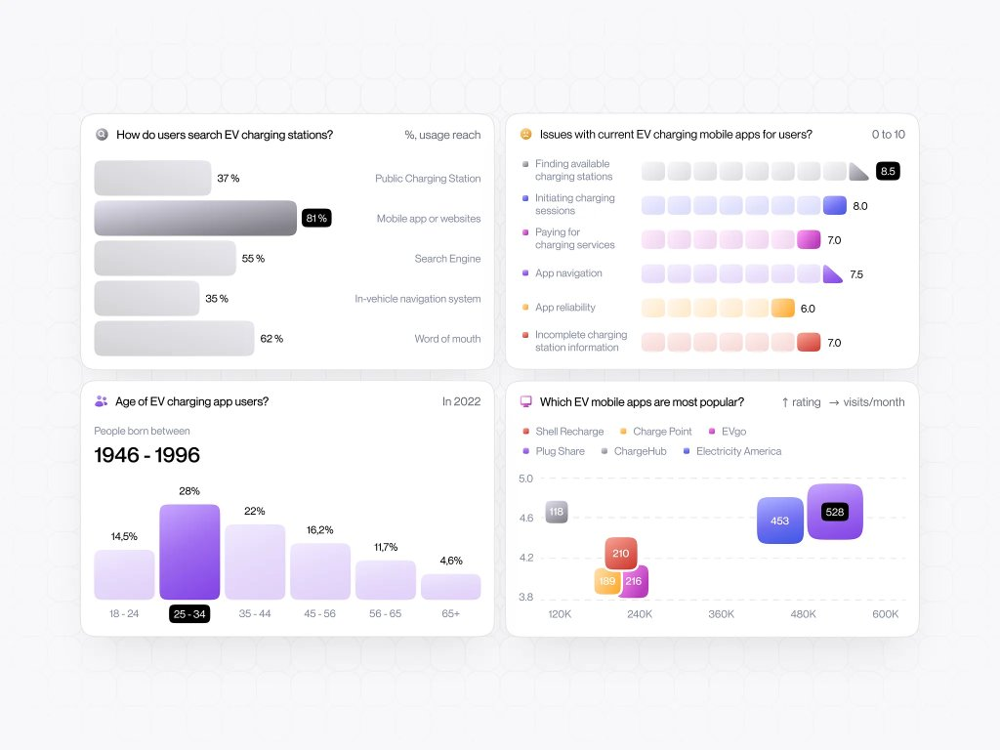
- **绝对链接**：[01_card_metrics_pill_bars.jpg](file:///Users/lbjlaq/Desktop/at/docs/assets/gui_references/01_card_metrics_pill_bars.jpg)
- **组件特征**：水平微型圆角进度胶囊、0~10 细分评分块、多维离散卡片矩阵。
- **账号详情映射**：
  - 映射至 **「模块 3：模型消耗列表」** 中的横向流速进度条（TPS）与多维技术参数排列；
  - 映射至 **「模块 1：实时额度概览」** 中的 5h / 7d 水位药丸胶囊。

---

#### 5.4.2 图谱 2：堆叠流线图与圆环拆解 (Stack Flow & Donut Breakdown)
- **本地图片**：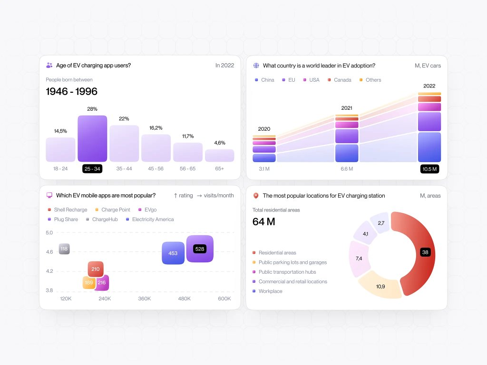
- **绝对链接**：[02_stack_flow_and_donut.jpg](file:///Users/lbjlaq/Desktop/at/docs/assets/gui_references/02_stack_flow_and_donut.jpg)
- **组件特征**：多层垂直渐变堆叠条图、右侧环形图（Donut Chart）带外部文字引线与加粗数字。
- **账号详情映射**：
  - 映射至 **「模块 2：Token 5 层水库构成拆解」**（Prompt、Cache Read、Thinking、Tools、Output）；
  - 映射至 **「Gemini vs Claude 核心消耗圆环」**。

---

#### 5.4.3 图谱 3：多色数据流管道拓扑 (Dataflow Pipeline Routing)
- **本地图片**：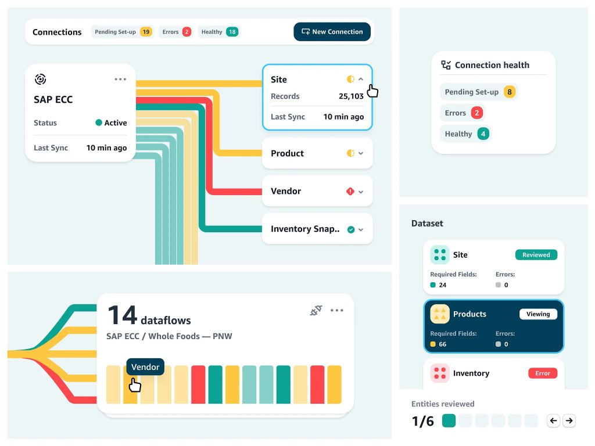
- **绝对链接**：[03_dataflow_pipeline_routing.jpg](file:///Users/lbjlaq/Desktop/at/docs/assets/gui_references/03_dataflow_pipeline_routing.jpg)
- **组件特征**：源节点（Source Node）向多个目标节点分流的彩色平滑流线管道（Flow Pipes），带状态指示与数量标注。
- **账号详情映射**：
  - 核心映射至 **「模块 4：项目消耗流向管道（Project Drain Flow）」**！从单账号节点流向 `at`、`omin`、`infra` 多个项目，管道宽度正比于消耗 Token 量。

---

#### 5.4.4 图谱 4：极简浅色 Bento 看板与横向排名 (Light Dashboard KPI & Bars)
- **本地图片**：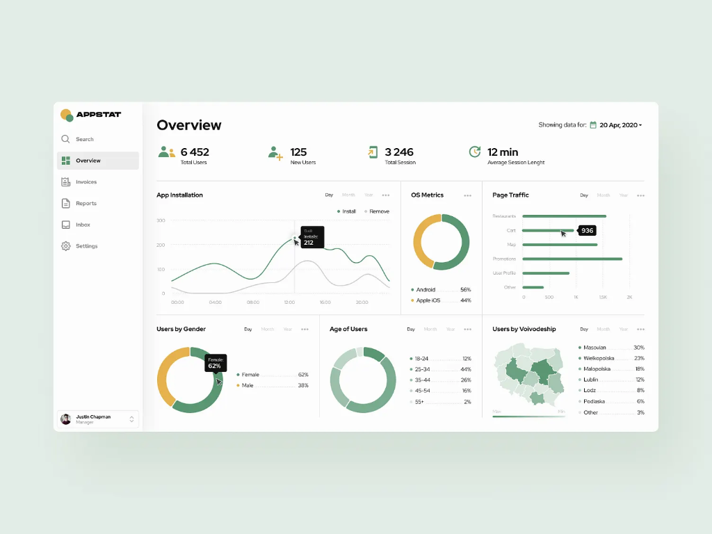
- **绝对链接**：[04_light_dashboard_kpi_bars.png](file:///Users/lbjlaq/Desktop/at/docs/assets/gui_references/04_light_dashboard_kpi_bars.png)
- **组件特征**：顶部 4 格轻量 KPI 数字方块（微弱彩色图标点缀）、平滑安装量曲线、水平排行条形图。
- **账号详情映射**：
  - 映射至 **「模块 2：4 大核心吞吐与省费方块」**（总吞吐、实耗金额、已省金额、平均流速）；
  - 映射至 **「模块 5：客户端消耗排行榜」**（IDE 70% / App 18% / Plugin 8% / CLI 4%）。

---

#### 5.4.5 图谱 5：暗夜竞技六边形能力雷达与会话表 (Dark Gaming Radar Profile)
- **本地图片**：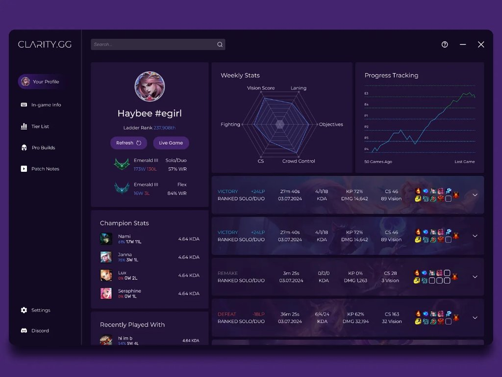
- **绝对链接**：[05_dark_gaming_radar_profile.jpg](file:///Users/lbjlaq/Desktop/at/docs/assets/gui_references/05_dark_gaming_radar_profile.jpg)
- **组件特征**：深色背景下的六边形多维能力雷达（Hexagonal Radar）、胜率折线走势图、紧凑的历史战绩对账表。
- **账号详情映射**：
  - 映射至 **「账号稳定性与综合算力雷达」**（吞吐量、缓存率、保真度、并发流速、抗 429 韧性）；
  - 映射至账号详情底部的 **「最近交互会话历史记录列表」**。

---

#### 5.4.6 图谱 6：圆形同心环仪表与双向发散对比条 (Circular Gauges & Divergence Bar)
- **本地图片**：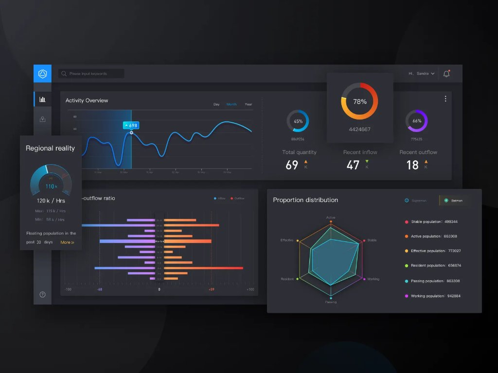
- **绝对链接**：[06_circular_gauges_divergence_bar.jpg](file:///Users/lbjlaq/Desktop/at/docs/assets/gui_references/06_circular_gauges_divergence_bar.jpg)
- **组件特征**：三组同心圆形进度环（45%、78%、66%）、双向中轴发散横向柱状条（Inflow / Outflow Ratio）。
- **账号详情映射**：
  - 映射至 **「模块 1：5h 与 7d 同心圆环水位仪表」**；
  - 映射至 **「模块 4：Gemini 输入 vs Claude 输出双向发散对比」**。

---

#### 5.4.7 图谱 7：双圆环任务仪表与彩色条形矩阵 (Dual Donut & Multi Progress)
- **本地图片**：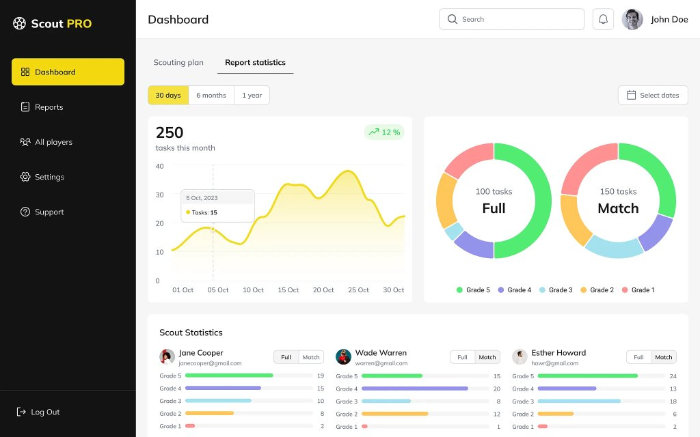
- **绝对链接**：[07_dual_donut_multi_progress.jpg](file:///Users/lbjlaq/Desktop/at/docs/assets/gui_references/07_dual_donut_multi_progress.jpg)
- **组件特征**：双大圆环居中数字（如 `100 tasks Full`, `150 tasks Match`）、多分类水平双色进度槽。
- **账号详情映射**：
  - 映射至 **「5h 与 7d 双核心额度圆环」**，中央大字标明剩余百分比与恢复时间；
  - 映射至项目明细中各个子模块的进度细分。

---

#### 5.4.8 图谱 8：金融投资组合大卡与半圆弧健康仪表 (Financial Portfolio & Half Gauge)
- **本地图片**：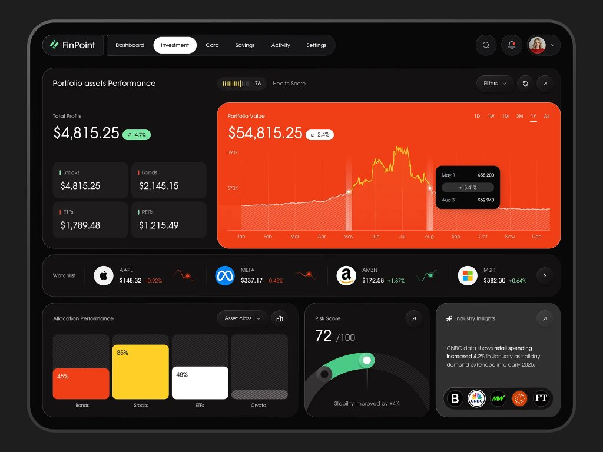
- **绝对链接**：[08_financial_portfolio_half_gauge.jpg](file:///Users/lbjlaq/Desktop/at/docs/assets/gui_references/08_financial_portfolio_half_gauge.jpg)
- **组件特征**：醒目的橙红渐变资产大卡片（$54,815.25 USD）、半圆弧健康度评分仪（Risk Score 72/100）、分块资产占比矩形。
- **账号详情映射**：
  - 核心映射至 **「模块 2：Token 换算金额大卡片（算力金库）」**，展示 `$214.50 USD` 累计价值；
  - 映射至账号健康评分仪表（`98/100` 健康良好）。

---

#### 5.4.9 图谱 9：高对比度时间区间波形焦点 (Focused Time Range Wave)
- **本地图片**：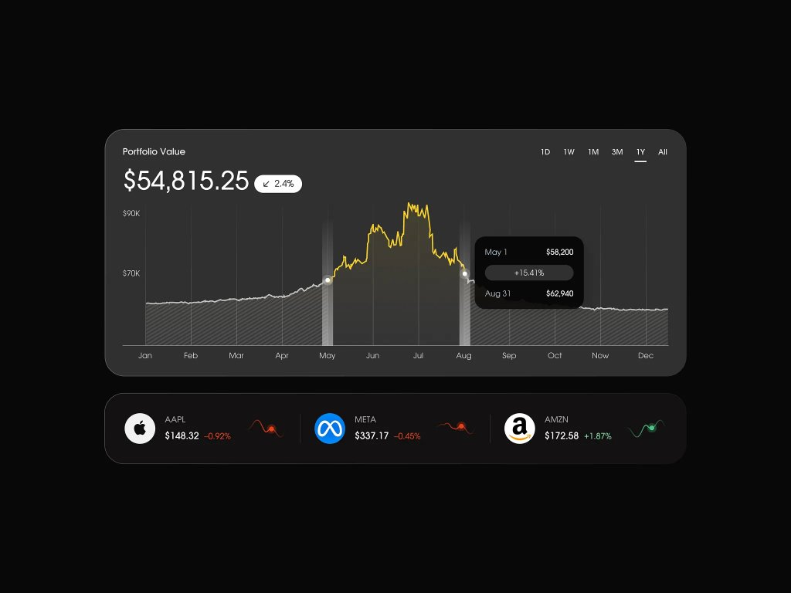
- **绝对链接**：[09_focused_time_range_wave.jpg](file:///Users/lbjlaq/Desktop/at/docs/assets/gui_references/09_focused_time_range_wave.jpg)
- **组件特征**：高对比度深黑背景折线波形、两道垂直高亮时间光标标定核心观察区间（`May 1` ~ `Aug 31`，带浮层增幅标签）。
- **账号详情映射**：
  - 映射至 **「账号 24 小时波峰与高负载区间标定」**，高亮突出开发者的重度编码黄金时间段。

---

#### 5.4.10 图谱 10：胶囊进度矩阵与甘特时间跨度 (Capsule Matrix & Project Timeline)
- **本地图片**：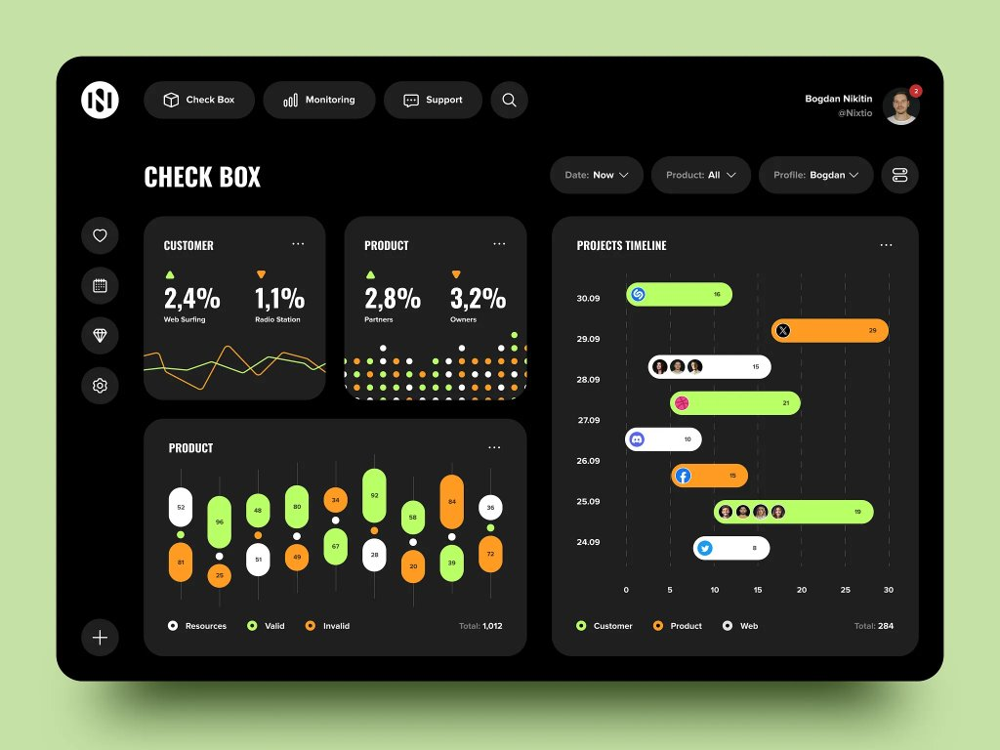
- **绝对链接**：[10_capsule_matrix_timeline.jpg](file:///Users/lbjlaq/Desktop/at/docs/assets/gui_references/10_capsule_matrix_timeline.jpg)
- **组件特征**：绿黄双色圆角胶囊柱状阵列、右侧水平浮动工程时间跨度色条（Projects Timeline）。
- **账号详情映射**：
  - 核心映射至 **「模块 6：24 小时活跃调用时间热力胶囊（Hourly Heatmap Capsules）」**；
  - 映射至各个项目在该账号上的活跃时间跨度甘特条。

---

#### 5.4.11 图谱 11：创作者多段分色条与打卡时间轴 (Creator Sheet & Segmented Bars)
- **本地图片**：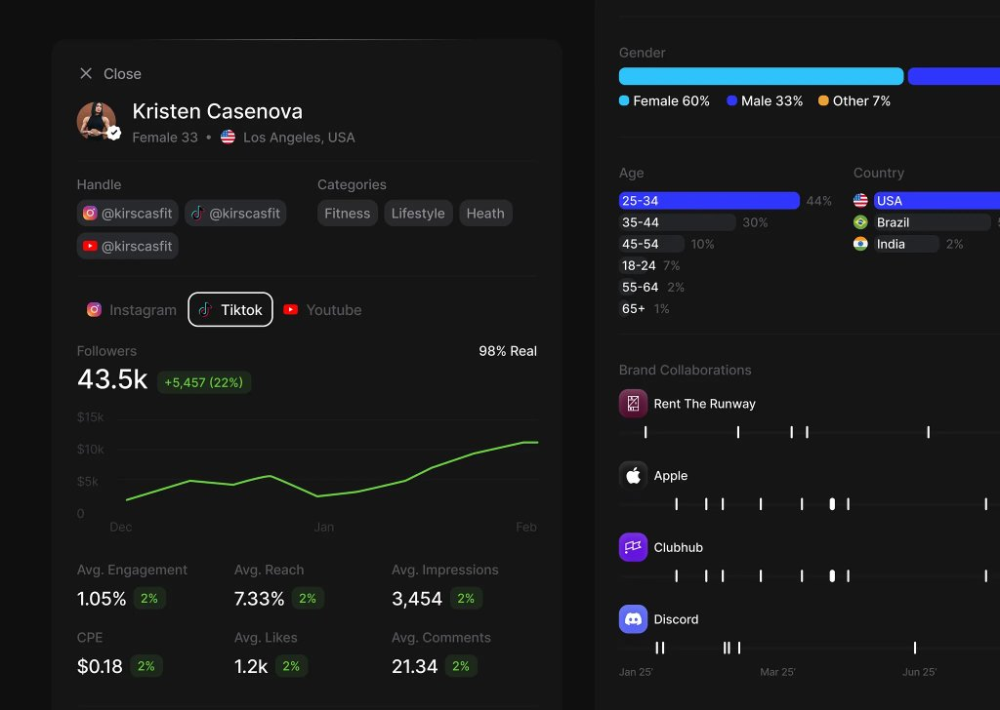
- **绝对链接**：[11_creator_sheet_segmented_bars.jpg](file:///Users/lbjlaq/Desktop/at/docs/assets/gui_references/11_creator_sheet_segmented_bars.jpg)
- **组件特征**：平滑收益曲线、顶部多段分色横向拼接进度条（`Female 60%, Male 33%, Other 7%`）、带离散刻度的打卡事件轴。
- **账号详情映射**：
  - 映射至 **「模块 2：Token 5 层水库横向拼接条」**（翡翠绿/蔚蓝/紫色/琥珀/粉红）；
  - 映射至账号各次请求的离散时间打卡刻度线。

---

#### 5.4.12 图谱 12：六边形蜂巢高密热力图 (Honeycomb Density Heatmap)
- **本地图片**：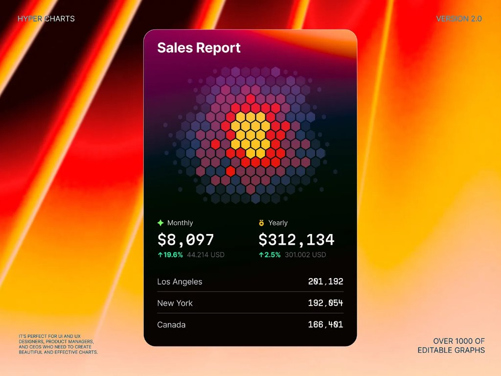
- **绝对链接**：[12_honeycomb_heatmap.jpg](file:///Users/lbjlaq/Desktop/at/docs/assets/gui_references/12_honeycomb_heatmap.jpg)
- **组件特征**：极具未来科技感的蜂巢六边形渐变高光热力分布（中心金黄高密、边缘幽蓝渐隐）。
- **账号详情映射**：
  - 可作为 **「极客模式：周级 7 天 × 24 小时高密调用热力图」** 的高阶视觉扩展。

---

#### 5.4.13 图谱 13：极坐标放射花形雷达与光芒图 (Radial Sparkburst & Radar)
- **本地图片**：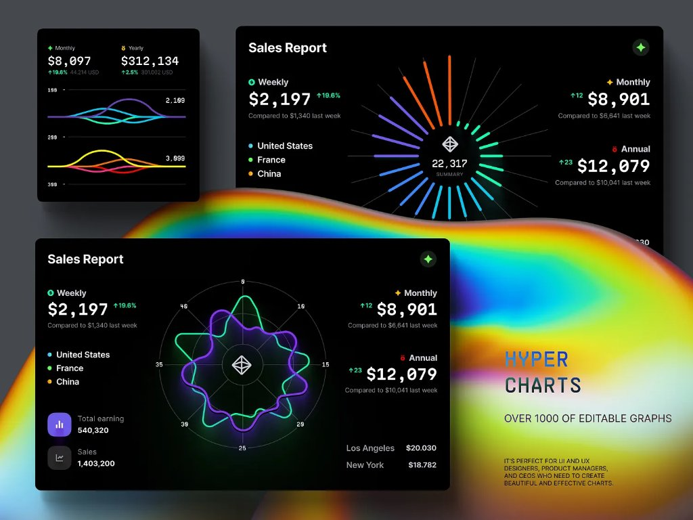
- **绝对链接**：[13_radial_sparkburst_radar.jpg](file:///Users/lbjlaq/Desktop/at/docs/assets/gui_references/13_radial_sparkburst_radar.jpg)
- **组件特征**：360 度圆周放射彩色光束图、同心圆上的波动花环雷达曲线。
- **账号详情映射**：
  - 映射至 **「24 小时生物钟极坐标环图」**，将 24 小时沿表盘圆周分布，直观看出午后与深夜的算力光芒喷射。

---

#### 5.4.14 图谱 14：暗夜微光桑基数据流图 (Glowing Sankey Dataflow)
- **本地图片**：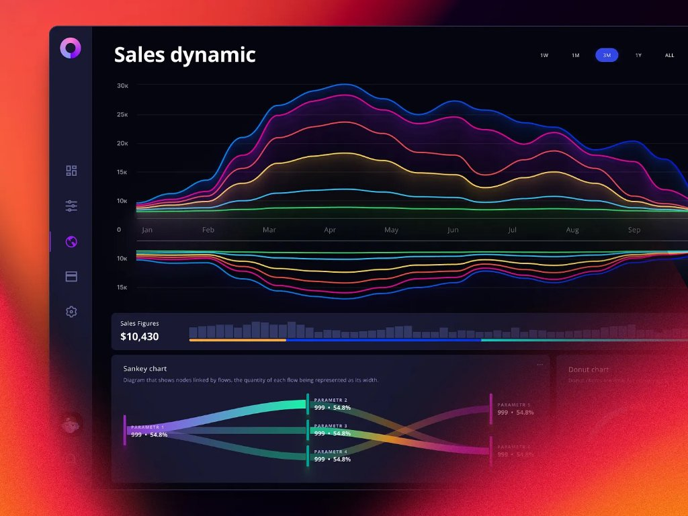
- **绝对链接**：[14_glowing_sankey_dataflow.jpg](file:///Users/lbjlaq/Desktop/at/docs/assets/gui_references/14_glowing_sankey_dataflow.jpg)
- **组件特征**：深色背景中带发光渐变的多分支桑基流（Sankey Chart），左侧输入平滑分流至右侧多条分支并标注流速与占比。
- **账号详情映射**：
  - 核心映射至 **「模块 4：账号 ➔ 模型 ➔ 项目的三级桑基流向图」**：
    `[当前账号]` ➔ `[Claude 3.7 / Gemini Pro]` ➔ `[at 工程 / omin 工程 / infra 工程]`。

---

#### 5.4.15 图谱 15：Apple 白 Bento 全套 UI Kit (Bento UI Kit & Arch Gauge)
- **本地图片**：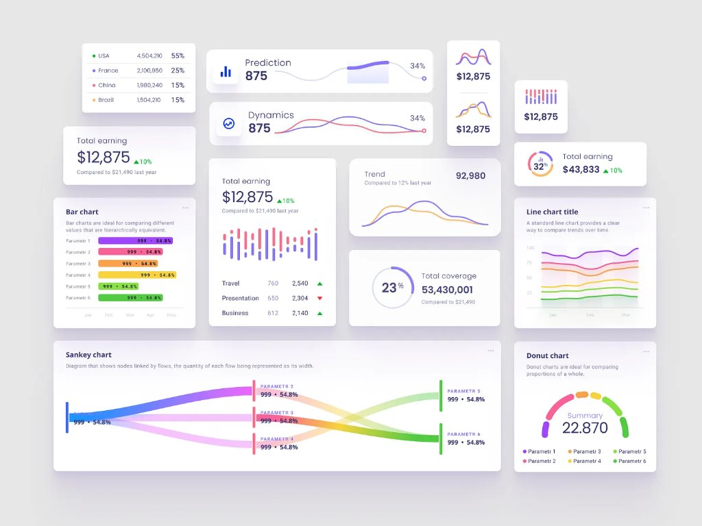
- **绝对链接**：[15_bento_ui_kit_sankey_arch.jpg](file:///Users/lbjlaq/Desktop/at/docs/assets/gui_references/15_bento_ui_kit_sankey_arch.jpg)
- **组件特征**：浅色 Apple 纯净微卡片合集，包含迷你 Sparkline 走势、圆角胶囊进度、微型桑基图以及半圆拱形进度仪（Arch Gauge: `Summary 22.870`）。
- **账号详情映射**：
  - 账号详情在**浅色模式 (Light Theme)** 下的终极设计蓝本；
  - 半圆拱形进度仪完美适配 **5h 额度 / 7d 额度的拱门式仪表**。

---

#### 5.4.16 图谱 16：暗黑 Bento 桑基流与气泡散点图 (Dark Bento Sankey & Bubble Matrix)
- **本地图片**：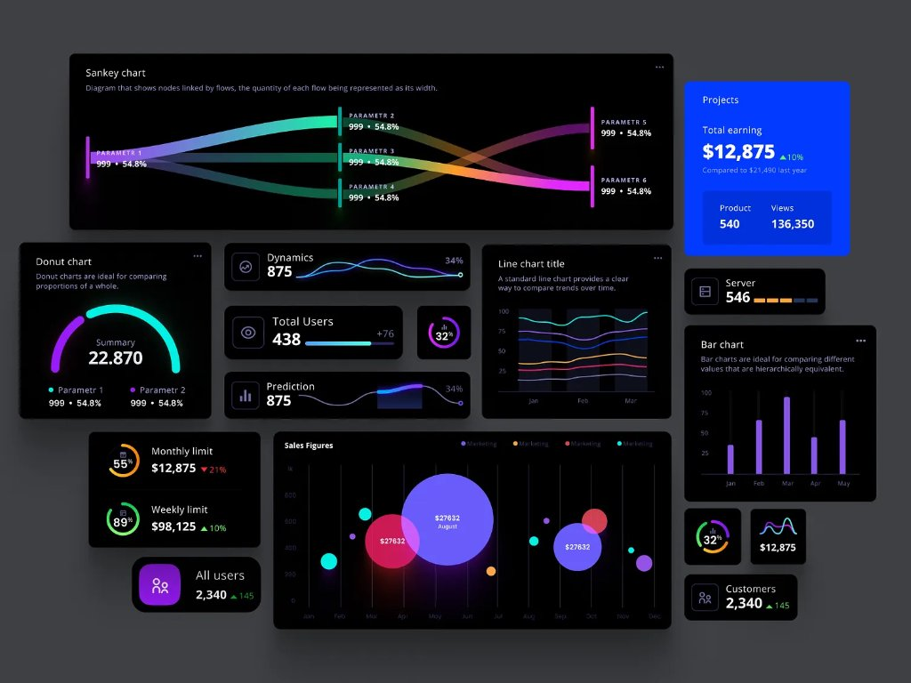
- **绝对链接**：[16_dark_bento_sankey_arch.jpg](file:///Users/lbjlaq/Desktop/at/docs/assets/gui_references/16_dark_bento_sankey_arch.jpg)
- **组件特征**：深黑底色下的发光桑基流图、拱门半圆环进度仪 (`22.870`)、气泡大小反映吞吐的多维气泡散点图、服务器负载小条块。
- **账号详情映射**：
  - 映射至 **「Token 算力金库半环仪表 (Arch Gauge)」**；
  - 映射至 **「项目与模型流向气泡图」**（气泡大小代表该工程消耗的 Token 量，气泡颜色区分 Gemini vs Claude）。

---

#### 5.4.17 图谱 17：多圈同心靶心额度仪表与状态清单 (Multi-Ring Target Gauge & Status Matrix)
- **本地图片**：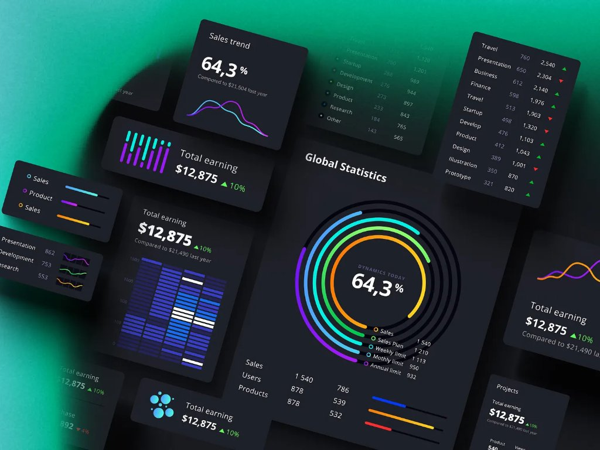
- **绝对链接**：[17_multi_ring_target_gauge.jpg](file:///Users/lbjlaq/Desktop/at/docs/assets/gui_references/17_multi_ring_target_gauge.jpg)
- **组件特征**：深绿背景中的五层同心圆环靶向仪表（`Dynamics Today 64.3%`），不同颜色环代表 Sales/Plan/Limit 多层水位，左下角带状态卡。
- **账号详情映射**：
  - 映射至 **「模块 1：多周期额度同心环雷达」**！最内环 5h 实时流速环、次内环 7d 周期水库环、外环每月总配额环，直观看到多重时间窗口的消耗进度。

---

#### 5.4.18 图谱 18：霓虹点阵活跃雷达与水平状态栏 (Neon Dot-Matrix Radar & Status Bar)
- **本地图片**：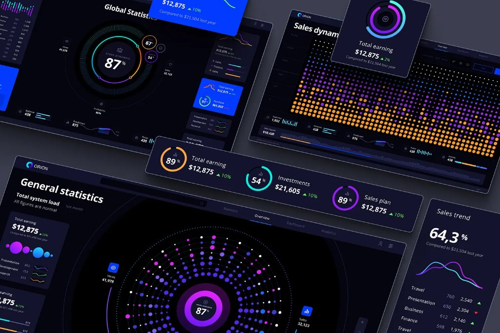
- **绝对链接**：[18_neon_dot_matrix_radar.jpg](file:///Users/lbjlaq/Desktop/at/docs/assets/gui_references/18_neon_dot_matrix_radar.jpg)
- **组件特征**：同心圆光芒雷达、点阵矩阵散点图、水平三段式微环卡片（`89% Total earning`、`54% Investments`、`89% Sales plan`）。
- **账号详情映射**：
  - 映射至 **「账号多状态水平卡片栏」**，每个卡片集成微型圆环（如健康度 98%、Gemini 100%、Claude 50%）；
  - 映射至 **「24h 点阵活跃度热力矩阵」**。

---

#### 5.4.19 图谱 19：高峰波浪山脉图与渐变水平排行条 (Peak Mountain Wave & Gradient Bars)
- **本地图片**：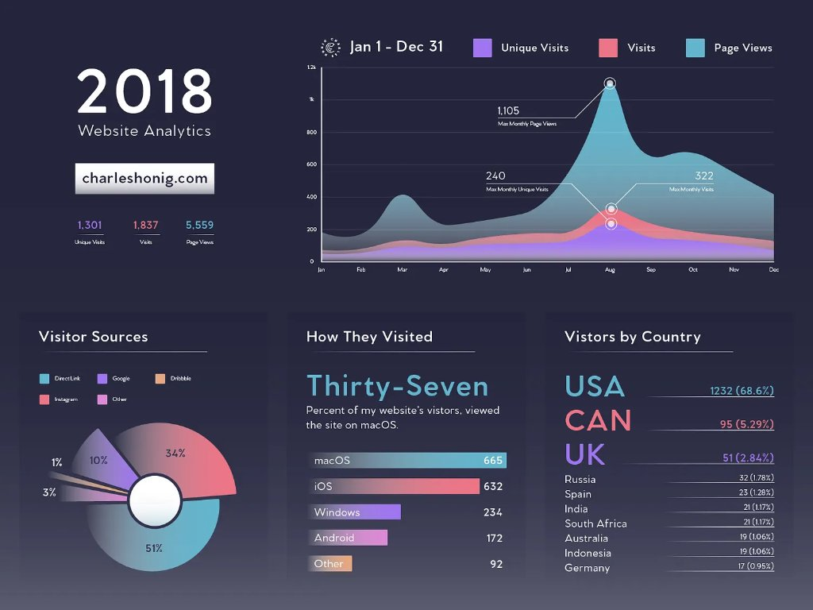
- **绝对链接**：[19_peak_mountain_wave_bars.jpg](file:///Users/lbjlaq/Desktop/at/docs/assets/gui_references/19_peak_mountain_wave_bars.jpg)
- **组件特征**：多层平滑山脉波形图带波峰节点气泡标定（`1,105 Max Page Views`、`240 Unique Visits`、`322 Visits`），右侧访问来源水平渐变条形图（`macOS 665`、`iOS 632`、`Windows 234`）。
- **账号详情映射**：
  - 映射至 **「Token 吞吐时序波峰波谷标注」**（在波峰处自动标出最大吞吐时刻与对应工程）；
  - 映射至 **「模块 5：客户端/宿主消耗排行榜的渐变条形图」**。

---

#### 5.4.20 图谱 20：极简白三色垂直堆叠柱状图与微火花线 (GitHub Stacked PRs & Sparklines)
- **本地图片**：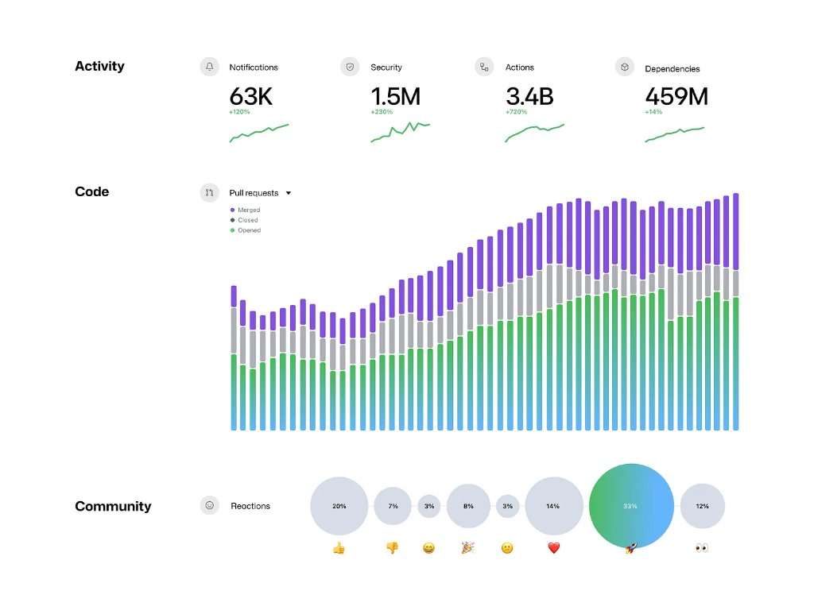
- **绝对链接**：[20_github_stacked_prs_bubbles.jpg](file:///Users/lbjlaq/Desktop/at/docs/assets/gui_references/20_github_stacked_prs_bubbles.jpg)
- **组件特征**：纯净白色背景、顶部 4 个大数字 KPI 带绿色走势火花线（Sparklines: `63K +120%`、`1.5M`、`3.4B`），核心为类似 GitHub PRs/Commits 的三色垂直堆叠柱状图（紫色/灰色/绿色）。
- **账号详情映射**：
  - 映射至 **「Token 3-Tier 垂直堆叠柱状图（Vertical Stacked Token Bars）」**：每根柱子垂直分为翡翠绿（缓存命中）、科技蓝（直接输入）、玫瑰粉（模型输出）；
  - 映射至各个指标卡中的微型走势火花线。

---

#### 5.4.21 图谱 21：周额度里程碑轨迹条与存钱罐对比 (Milestone Track & Savings Ledger)
- **本地图片**：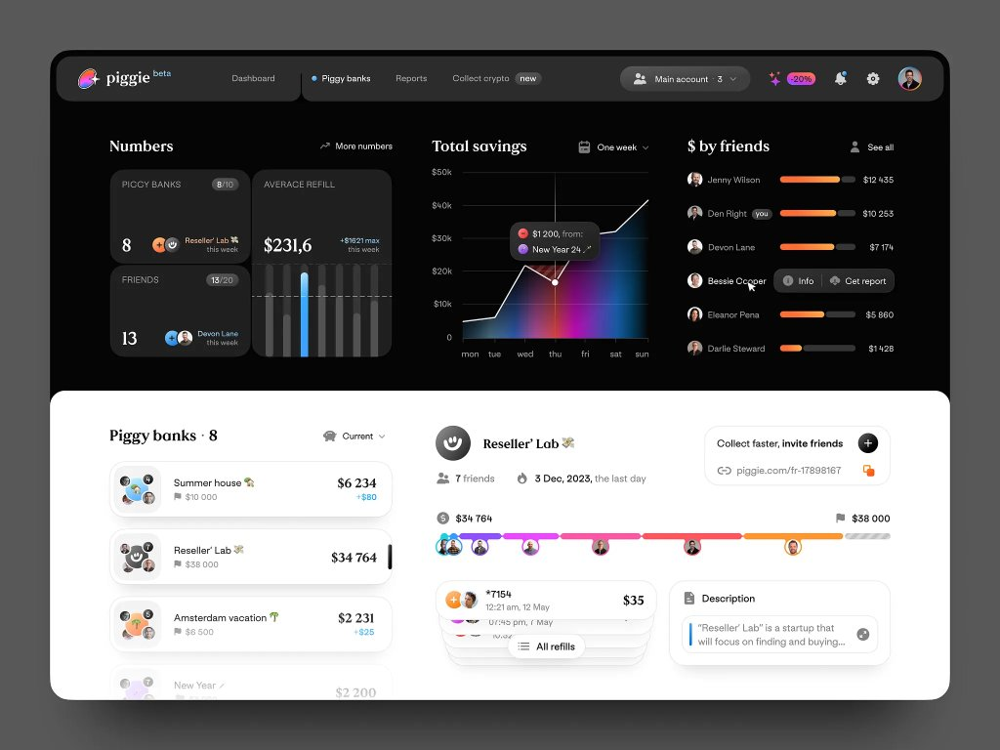
- **绝对链接**：[21_milestone_track_timeline.jpg](file:///Users/lbjlaq/Desktop/at/docs/assets/gui_references/21_milestone_track_timeline.jpg)
- **组件特征**：上部深色总资产走势折线图，下部浅色卡片，包含水平彩色彩带里程碑轨迹条（Milestone Track），沿途附带里程碑节点、头像徽章与终点旗帜（`$34 764` -> `$38 000`）。
- **账号详情映射**：
  - 映射至 **「周额度消耗里程碑轨迹条」**！在一条平滑彩线上标注各工程当前已消耗的额度里程碑与 7d 耗尽阈值旗帜；
  - 映射至 **「Prompt Caching 累计节省金库清单」**。

---

#### 5.4.22 图谱 22：行程遥测轨迹与竖向活动日志卡片流 (Telemetry Checkpoints & Activity Log)
- **本地图片**：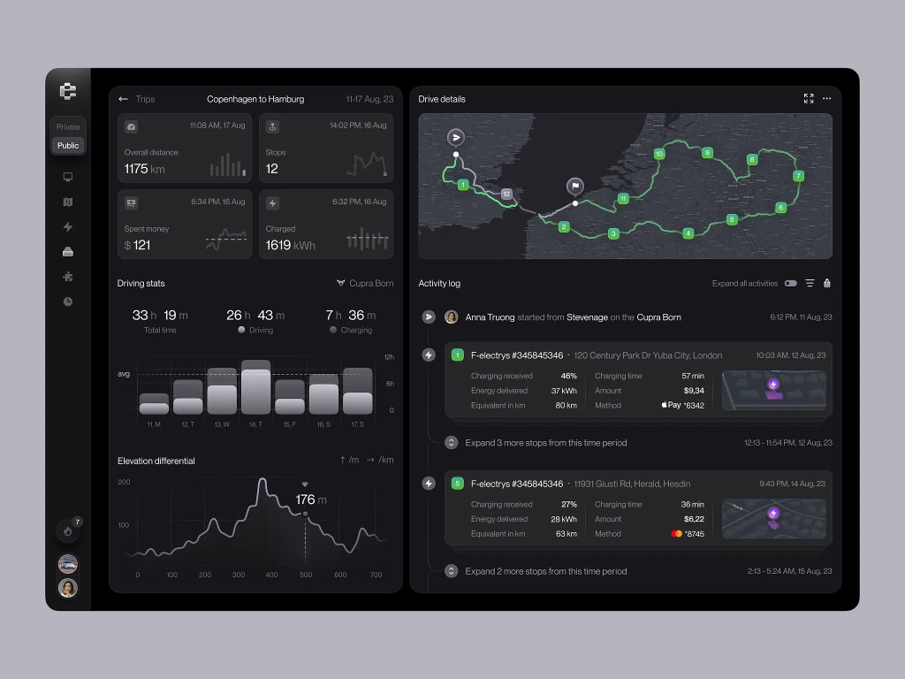
- **绝对链接**：[22_telemetry_trip_checkpoints.jpg](file:///Users/lbjlaq/Desktop/at/docs/assets/gui_references/22_telemetry_trip_checkpoints.jpg)
- **组件特征**：深色车辆遥测界面，左侧里程/耗电柱状图与高程波形，右侧竖向活动日志时间轴卡片流（Activity log cards），带绿色编号圆圈、状态药丸（`46% Charging received`、`37 kWh`、`57 min`、`$9.34`）。
- **账号详情映射**：
  - 映射至 **「账号近期会话与请求轨迹卡片流 (Recent Activity Log Cards)」**，每个会话清晰标出使用的项目工程、模型、消耗 Token 与生成流速。

---

#### 5.4.23 图谱 23：粒子流电池卡与彩色堆叠时序柱 (Electrys Particle Battery & Multi-Color Bars)
- **本地图片**：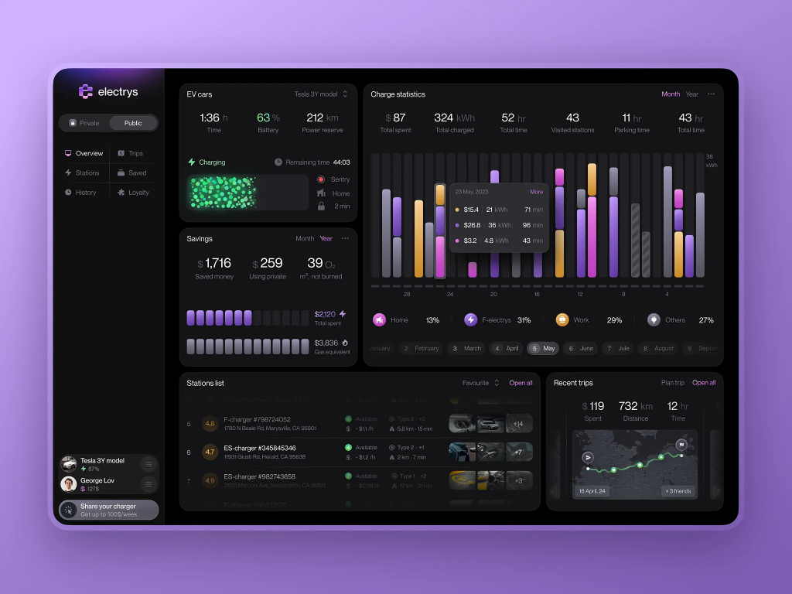
- **绝对链接**：[23_electrys_particle_stacked_bars.png](file:///Users/lbjlaq/Desktop/at/docs/assets/gui_references/23_electrys_particle_stacked_bars.png)
- **组件特征**：深黑暗紫科技界面，左侧电池卡带流动微粒子光晕动画（`63% Battery`），右侧核心为每小时彩色多段垂直堆叠柱，悬停滑出多指标 Tooltip（`23 May, 2023 - $15.4 · 21 kWh · 71 min`），底部带分类占比徽章。
- **账号详情映射**：
  - 映射至 **「5h / 7d 实时额度粒子流动态电池卡」**，直观显示电量与充放电状态；
  - 映射至 **「模块 6：24 小时高保真彩色堆叠柱状热力图」**，悬停即透视每小时详细指标。

---

#### 5.4.24 图谱 24：三维地形等高线打卡与双向浮动指标条 (Topographic 3D Wireframe & Floating Bars)
- **本地图片**：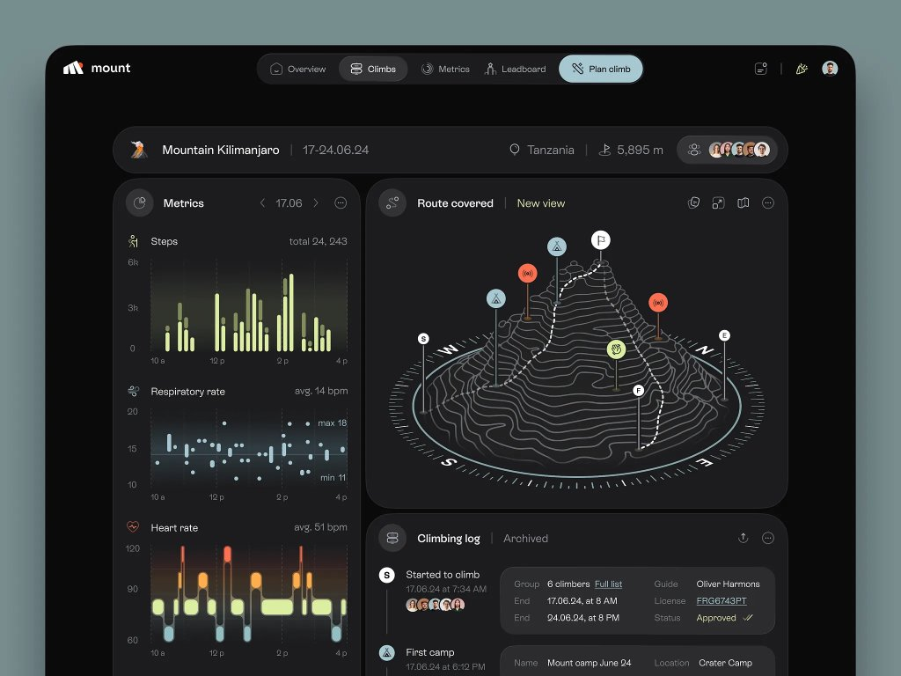
- **绝对链接**：[24_topographic_3d_scatter_bars.jpg](file:///Users/lbjlaq/Desktop/at/docs/assets/gui_references/24_topographic_3d_scatter_bars.jpg)
- **组件特征**：未来感三维等高线立体地形图带路径打卡旗帜，左侧上下双向浮动连接条（Heart rate bidirectional floating bars）、散点律动图，底部登山归档日志。
- **账号详情映射**：
  - 映射至 **「双向流速浮动条（Throughput Floating Bars）」**，展示流速的上下波动范围；
  - 映射至 **「工程开发会话登山打卡日记」**。

---

## 6. 系统设置（Settings & Automation）详细设计

系统设置采用 macOS System Settings 经典的**分段控制器 (Segmented Tabs)** 布局，彻底消除长页面滚动查找的认知疲劳。四大子 Tab 权责极其鲜明：

```
┌────────────────────────────────────────────────────────────────────────────────────────┐
│  ⚙️ 系统设置      [ 🛡️ 智能调度与切号 ]  [ ⏱️ 配额轮询与常规 ]  [ 📦 备份与安全 ]  [ ℹ️ 关于本软件 ] │
└────────────────────────────────────────────────────────────────────────────────────────┘
```

### 6.1 子 Tab 1：🛡️ 智能调度与切号（Routing & Automation）
> **核心职能**：配置全自动故障自愈触发条件、智能选号策略与模型偏好池。

1. **自动故障切换 (Auto-Failover Trigger)**：
   - 主控开关：`当主力账号配额耗尽时自动切换` [  ON / OFF  ]。
   - 保护靶标多选框（精细到目标宿主）：
     - `☑️ Antigravity 原生桌面版 (App)`
     - `☑️ Antigravity IDE 定制版 (IDE)`
     - `☐ ACP 外部插件 (Cursor / VSCode Plugin)`
   - 触发阈值调节：`当主力模型剩余配额 <= 0% 时触发`（支持滑块 0% ~ 10% 微调）。
   - 429 速率限制自愈：`☑️ 遭遇 Google 429 限流时立即尝试轮转下一可用账号`。
2. **智能选号调度策略 (Account Selection Strategy)**：
   - **策略模式单选器 (Strategy Mode)**：
     - `[•] 最高配额优先 (Max Quota - 默认推荐)`：永远挑当前池子里可用额度最高的账号，保障高强度编码连续性。
     - `[ ] 轮询最久未用 (Least-Used / Round-Robin)`：优先挑选最久未调用的账号，保障负载均衡，给冷却账号留足 5h/7d 恢复周期。
     - `[ ] 优先级权重优先 (Priority Weighted)`：严格遵循账号自身的 Priority 数字。
     - `[ ] 随机负载均衡 (Random Shuffle)`：适合账号量极大时的随机离散分发。
   - **模型配额池偏好 (Model Pool Preference)**：
     - `[•] 综合均衡 (Balanced)`：Claude 与 Gemini 综合可用率最高。
     - `[ ] Claude 池优先 (Claude Preferred)`：优先挑 Sonnet 3.7 / 3.5 额度充足的号。
     - `[ ] Gemini 池优先 (Gemini Preferred)`：优先挑 2.5 Pro / Flash 充足的号。
   - **生效标签限定 (Tag Scoping)**：
     - 下拉菜单：`仅在带有 [🌟主力] 或 [VIP] 标签的账号池内自动轮转`（防止误切至测试账号）。
3. **系统通知反馈 (Notification Feedback)**：
   - `☑️ 自动切号成功后，发送 macOS 原生系统横幅通知`。

### 6.2 子 Tab 2：⏱️ 配额轮询与常规（Polling & General）
> **核心职能**：后台轻量保鲜与桌面常规偏好。

1. **后台静默配额轮询 (Silent Quota Polling)**：
   - 主控开关：`开启定时静默轮询` [  ON / OFF  ]。
   - 轮询间隔滑块：`15 分钟 ~ 120 分钟`（默认 30 分钟）。
   - 绿色节能模式：`☑️ 仅轮询当前正在运行宿主的账号 (减少 90% 不必要请求，降低风控概率)`。
   - Jitter 保护：内置 $\pm 3$ 分钟随机抖动，杜绝整点机械化请求。
2. **系统常规偏好 (System Preferences)**：
   - 开机启动：`☑️ 随系统开机静默启动 (并在后台常驻)`。
   - 窗口关闭行为：
     - `[•] 最小化到系统菜单栏托盘 (保持后台自动守护运行)`
     - `[ ] 直接完全退出应用程序`
   - 主题外观：`[ 跟随系统 ]` `[ 浅色 Light ]` `[ 深色 Dark (Apple 风格暗夜磨砂) ]`。

### 6.3 子 Tab 3：📦 备份与安全（Backup & Fingerprint）
> **核心职能**：账号资产迁移与设备指纹安全隔离。

1. **便携备份与数据恢复 (Data Portability)**：
   - `[ 📦 导出账号备份包 (backup.json) ]`：一键导出所有账号的 Token、配额快照与标签。
   - `[ 📥 从备份包恢复账号... ]`：支持选择“增量跳过”或“覆盖已有”。
2. **设备指纹隔离与环境自愈 (Device Isolation & Cleanup)**：
   - 实时展示当前环境的设备指纹特征快照（Machine ID、SQM GUID、Service Machine ID）。
   - 动作：`[ 🔄 重新生成设备指纹 ]`。
   - 残留会话自愈：`[ 🧹 清理 GitHub Copilot / VSCode Sync 残留会话 ]`（杜绝多账号被云端反向关联串号）。

### 6.4 子 Tab 4：ℹ️ 关于本软件（About Antigravity Manager）
> **核心职能**：传承主分支工匠精神，对齐 Apple 风格关于面板（About This Mac 风格）。

1. **品牌与版本识别**：
   - 精致的 Antigravity 拟物立体 App Icon（支持微光晕呼吸效果）。
   - 产品名称：**Antigravity Manager**。
   - 核心版本：`v4.9.0 (Apple Silicon Native / Universal)`。
   - 底层 SDK：`am-core v0.1.0`（纯本地零代理架构）。
2. **核心特性声明**：
   - `🛡️ 100% 零代理网络穿透 · 纯本地官方对齐`
   - `⚡ 4 大宿主秒级热切换 (App, IDE, Plugin, CLI)`
   - `📊 亚秒级本地 SQLite 会话流速与水位多维洞察`
3. **致谢、开源与更新检查**：
   - 开发者与维护者：`Maintained with ❤️ by @jeikl & @cubelikeplayDaniel & Community`。
   - 检查更新：`[ 🔄 检查新版本 ]`（支持自动检测发布通道）。
   - 官方链接群：`[ 🌐 GitHub 仓库 ]` `[ 📝 更新日志 (Changelog) ]` `[ 💬 交流与反馈 ]`。

---

## 7. 通用公共组件库规范 (Apple HIG Common Components)

为了确保全软件在视觉质感、交互反馈与系统性能上的一致性，设计统一的高阶通用组件库：

### 7.1 系统级多模态通知系统 (Notification & Toast System)
通知系统采用双通道架构，区分“应用内微交互”与“系统级后台事件”：

1. **通道 A：Apple 级应用内浮动胶囊 (In-App Dynamic Capsule Toast)**：
   - **视觉规范**：类似 iOS 灵动岛 (Dynamic Island)，顶部中央微悬浮，极细深灰边框 + 毛玻璃高斯模糊 (`backdrop-blur-xl`)。
   - **交互形态**：
     - 成功提示（绿色微光）：`✓ 账号已成功切至 Antigravity IDE (0.1s)`。
     - 警示提示（琥珀色微光）：`⚠️ 检测到模型流速异常降级 (48 tok/s)`。
     - 错误提示（红色微光）：`✕ 授权过期 (401)，已自动标记该账号`。
   - **物理动效**：采用弹性弹簧阻尼 (Spring Physics: damping 25, stiffness 300)，展开持续 3 秒后柔和收起。
2. **通道 B：macOS 原生系统横幅通知 (System Desktop Banner)**：
   - 当应用程序窗口最小化或处于后台时，通过系统原生通道推流。
   - 典型场景：`“Antigravity 自动切号：原生 App 额度耗尽，已自动切至 user2@gmail.com”`。

### 7.2 模态与侧滑抽屉规范 (Modal & Slide-Over Sheet)
1. **轻量侧滑抽屉 (Slide-Over Inspector Sheet)**：
   - 宽度：`420px`，从视窗右侧平滑滑出，底层主画布轻微缩放压暗 (Scale 0.98)。
   - 应用场景：流量流水中的“单次请求深度透视”、账号卡片中的“细分模型额度明细抽屉”。
2. **微交互确认框 (Popover Confirm)**：
   - 拒绝大面积阻断式 Alert 弹窗。
   - 删除账号、禁用等危险操作，直接在点击按钮上方弹出指向性微型确认气泡：`“确定删除该账号？[取消] [确定]”`，点外部空白处自消。

### 7.3 进度条与多环图元规范 (Gauges & Progress Primitives)
1. **Squircle 双同心环 (Concentric Dual Rings)**：
   - 统一 SVG 矢量渲染，支持 High-DPI 视网膜屏幕。外环 6px、内环 4px，间距 3px，底轨半透明 15%，亮轨渐变发光。
2. **分段水库水位条 (Segmented Reservoir Bar)**：
   - 支持圆角内嵌、分段彩色拼接（翠绿/蔚蓝/紫色/琥珀/粉红），鼠标悬停各分段时显示 Tooltip 数据分解。

### 7.4 标签选择胶囊 (Interactive Tag Pill)
- 尺寸统一：高 `22px`，字体 `11px`，字重 Medium。
- 支持 8 种官方语义预设配色：
  - `🌟 主力` (金色光泽)
  - `🟣 Claude池` (优雅紫罗兰)
  - `🔵 Gemini池` (科技蔚蓝)
  - `VIP` (琥珀黄)
  - `备用` (静谧银灰)
  - `测试` (冰蓝)

---

## 8. 主分支 UI 样式与设计语言提取规范 (Design Tokens & Layout DNA)

为了保持与主分支视觉灵魂与用户肌肉记忆的 100% 连续性，同时遵循 Apple HIG 的原生质感，我们从主分支的核心样式中提取了以下设计规范（Design Tokens & CSS DNA）：

### 8.1 经典双模色彩系统 (Color Tokens)

主分支采用了深邃细腻的 Obsidian（黑曜石）与 Slate-Charcoal（板岩木炭）色彩层次，完全保留并对齐：

```css
/* 主分支 Design Tokens 映射 */
:root {
  /* 浅色主题 (Light Mode) */
  --color-bg-canvas: #FAFBFC;        /* 主分支经典画布浅灰白底色 */
  --color-base-100: #FFFFFF;         /* 纯白卡片主背景 */
  --color-base-200: #F4F5F7;         /* 次级表面/悬停底色 */
  --color-base-300: #E2E8F0;         /* 边框与分割线色 (Borders & Dividers) */
  --color-base-content: #1E293B;     /* 主文本色 */
  
  /* 品牌语义色 (Brand Semantics) */
  --color-primary: #3B82F6;          /* 主色：科技蔚蓝 (Primary Blue) */
  --color-secondary: #64748B;        /* 次级辅助色 (Slate Gray) */
  --color-success: #10B981;          /* 成功/健康色：高光翡翠绿 (Emerald Green) */
  --color-warning: #F59E0B;          /* 告警/冷却色：琥珀金 (Amber Warning) */
  --color-error: #EF4444;            /* 错误/耗尽色：珊瑚红 (Rose Red) */
  --color-info: #0EA5E9;             /* 提示色：天空蓝 (Sky Blue) */
  --color-claude-purple: #8B5CF6;    /* Claude 专属语义紫 (Claude Violet) */
}

.dark {
  /* 深色主题 (Dark Mode - 主分支经典黑曜石质感) */
  --color-bg-canvas: #09090B;        /* 极深背景 (Deep Obsidian) */
  --color-base-100: #0B0C0E;         /* 主卡片底层 (Base Dark Card) */
  --color-base-200: #15161B;         /* 悬浮与嵌套表面 (Elevated Slate Surface) */
  --color-base-300: #26272F;         /* 微反光边框与输入框底色 (Crisp Borders) */
  --color-base-content: #F4F4F5;     /* 高对比明亮文本 */
  
  /* 深色下 Switch 与开关激活高光色 */
  --app-toggle-active: #3B82F6;
}
```

### 8.2 视窗与原生拖拽规范 (Window & Chrome Drag)

主分支最核心的视窗交互细节：
1. **全局原生拖拽区 (Native Drag Region)**：
   - 顶部固定高度为 `36px (h-9)` 的原生拖拽条，使用 JS 拦截 `getCurrentWindow().startDragging()`，彻底解决 HTML 默认 `data-tauri-drag-region` 在 Webview 内偶发失效的系统缺陷。
2. **防橡皮筋与过滚动拦截 (Overscroll Prevention)**：
   - 全局注入 `overscroll-behavior: none;`，消除 macOS Webview 页面边缘拉扯晃动的网页感。
3. **Mini 悬浮窗纯净透明度 (Zero-Border Mini View)**：
   - 在 Mini / Popover 模式下注入 `background: transparent !important;`，彻底消除直角黑白边框与滚动条突兀边缘，完美透出系统的真实圆角与毛玻璃阴影。

### 8.3 布局与排版 DNA (Typography & Spacing)

1. **字体栈 (System Font Stack)**：
   ```css
   font-family: -apple-system, BlinkMacSystemFont, "SF Pro Text", "SF Pro Display",
     "Segoe UI", "Roboto", "Helvetica Neue", sans-serif;
   -webkit-font-smoothing: antialiased;
   -moz-osx-font-smoothing: grayscale;
   ```
2. **卡片圆角与微边框 (Squircle & Micro-Borders)**：
   - 卡片采用 `rounded-xl (12px)` 或 `rounded-2xl (16px)`。
   - 边框采用 `border border-base-300/60 dark:border-base-300/40`，呈现微弱的半透明金属切边质感。
3. **跨平台极致丝滑主题扩散动效 (Ultra-Smooth GPU Clip-Path Transition)**：
   - **摒弃笨重矢量蒙版**：彻底废弃需要每帧 CPU 重新光栅化的 5000px `<feGaussianBlur>` SVG Mask 方案，解决 Windows WebView2、Linux WebKitGTK 与核显环境下的掉帧、撕裂与全屏雾化卡顿。
   - **GPU 片元着色器实时裁切**：采用 Web Animations API 驱动 `clip-path: circle(0px at x y) -> circle(endRadius at x y)`，由 GPU 片元管线直接硬件加速计算。
   - **动态精准外接圆计算**：
     $$r_{\text{end}} = \text{hypot}(\max(x, w - x), \max(y, h - y))$$
     根据当前窗口物理分辨率与触发点实时计算最小精确外接圆，杜绝超大屏下任何几何浪费与计算冗余。
   - **Apple 工业级阻尼曲线**：采用 `duration: 480ms` 与 `cubic-bezier(0.16, 1, 0.3, 1)`，兼顾呼吸感与干脆利落的响应速度，全平台满帧 120Hz，内存零常驻。

### 8.4 导航栏与布局架构 (Navbar Structure)

继承主分支经典导航栏的组件职责分离：
- **`NavLogo`**：品牌识别、状态心跳呼吸灯与快捷 Mini 窗口切换入口。
- **`NavMenu`**：居中的胶囊分段导航器，支持平滑滑块（Framer Motion 滑动下划线）。
- **`NavSettings`**：右侧常驻的语言切换、主题日光/月光扩散切换器、关于与快捷状态。

---

## 9. 极限性能与全平台硬件兼容规范 (Cross-Platform & Low-Spec Performance Guardrails)

为了彻底根除 Webview 客户端在 **Windows (WebView2)、Linux (WebKitGTK) 以及低分辨率、低性能核显屏幕** 下的卡顿、撕裂、掉帧与高内存占用问题，前端工程全面确立以下**铁律规范**：

### 9.1 动画与渲染三严禁 (Animation Anti-Patterns)
1. **严禁使用 JS 驱动的高频逐帧动画引擎 (如 Framer Motion)**：
   - 彻底避免每一帧在 JS 主线程与 Webview 渲染层之间传递状态，杜绝高负载业务下抢占主线程引发的界面掉帧。
2. **严禁使用全屏像素级位图遮罩 (如 startViewTransition clip-path 截图动画)**：
   - 全屏位图计算在无独立显卡的核显、Retina 视网膜屏或 Linux 软件光栅化环境下会导致 CPU 瞬间拉满与卡顿，甚至诱发 Linux WebKitGTK 崩溃。
3. **严禁在高频容器上使用导致重排 (Reflow) 的 CSS 属性动画**：
   - 动画仅允许针对 `transform: translate3d(...)` 和 `opacity` 进行 GPU 独立合成层加速，禁止针对 `width`、`height`、`margin`、`filter: blur(...)` 进行高频插值动画。

### 9.2 跨平台低开销渲染基石 (The 120Hz Low-Memory Stack)
- **动效引擎**：100% 纯 CSS GPU 硬件加速 + 经典 Apple 弹簧阻尼曲线 (`cubic-bezier(0.16, 1, 0.3, 1)`)，开启 `will-change: transform` 强制显存独立层，零运行时，真 120Hz 丝滑。
- **组件原子**：Radix UI 无头基础组件 (Headless Primitives) + Tailwind Atomic CSS，无样式包袱，按需加载，内存占用控制在 `< 25MB`。
- **日夜主题过渡**：采用系统级平滑透明度双向淡入 (`transition: background-color 150ms ease, border-color 150ms ease`)，在任何核显上均做到 0 延迟秒切。
- **低分辨率屏幕自适应 (Responsive Downscaling)**：
  - 弹性容器查询 (`@container`)，在宽屏下呈现完整图标与文字，在窄屏（< 880px）或低缩放屏幕下自适应收窄 Padding 并平滑折叠为图标模式，绝不出现内容溢出或截断。
